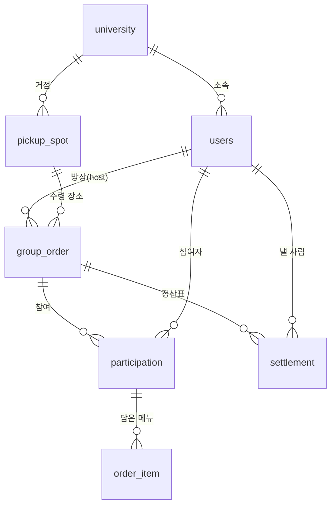

# Bandal - 배달음식 공동구매

## 1. 무엇을 만드는가

1인분만 먹고 싶은데 가게의 최소주문금액이 그보다 높아서, 먹지도 않을 메뉴를 억지로
담게 되는 문제를 푼다. 같은 수령 거점(기숙사 로비, 캠퍼스 건물 등)에 있는 사람들이
같은 가게에서 각자 1인분씩 담아 최소주문금액을 함께 채우고, 음식이 도착하면 각자
가져간다. 방장이 대표로 배달앱에서 주문하고, Bandal은 모집 / 메뉴 취합 / 정산 계산을
담당한다.

**대학 단위 서비스다.** 학교 이메일로만 가입할 수 있고, 거래는 같은 학교 안에서만
일어난다. 트리거는 "지금 배고픈데 혼자 시키기엔 최소주문금액이 부담된다".

대학으로 좁힌 이유

- 매칭에 필요한 "같은 시각 x 같은 가게 x 같은 수령지" 교집합이 캠퍼스에서는 실제로
  생긴다. 도보 몇 분 거리에 같은 시간대에 배고픈 사람이 수백 명 있다.
- 학교 이메일이 신원 확인과 거점 자격 확인을 동시에 해준다. 별도의 거점 인증 절차가
  필요 없다.
- 수령 장소가 자연스럽게 정해진다. 기숙사 로비, 건물 앞처럼 모두가 아는 지점이 이미
  있다.
- 나중에 학교와의 제휴로 확장할 여지가 있다.

배달비 절약은 부가 효과지 핵심이 아니다. 배달비는 이미 배달앱들이 알뜰배달 같은
걸로 어느 정도 눌렀지만, 최소주문금액은 가게가 정하는 값이라 아무도 못 건드린다.

## 2. 핵심 시나리오

1. A가 기숙사 로비 거점에 "○○마라탕 / 19:30 마감 / 최소주문 15,000원" 방을 연다.
   자기 메뉴(8,000원)를 먼저 담는다.
2. 같은 거점의 B가 모집중인 방 목록에서 이 방을 본다. `8,000 / 15,000 (53%)`로 표시된다.
3. B가 참여해 메뉴명과 가격을 직접 입력한다(마라탕 소, 9,000원). 합계 17,000원이 되어
   최소주문금액을 넘긴다.
4. 마감 시각이 되거나 방장이 직접 마감하면 방이 `마감` 상태가 된다. 이후 참여와 메뉴
   변경은 막힌다.
5. 방장이 배달앱 장바구니를 채워 배달비를 확인하고(결제는 아직 안 한다) 그 배달비를
   Bandal에 입력한다 -> `정산중`. 이때 정산표가 만들어진다. (ADR-029)
6. B에게 "9,000 + 배달비 분담 1,166 = 10,166원"과 방장 계좌, 송금 링크가 보인다.
   B가 송금하고 "보냈어요"를 누른다.
7. 방장이 입금을 확인하며 체크한다. 전원 확인되면 방장이 배달앱에서 실제로 결제하고
   `주문완료`로 바꾼다. 받은 돈과 자기 몫으로 결제하는 것이므로 방장은 외상을 놓지 않는다.
8. 음식이 도착하면 방장이 `배달완료`로 바꾸고, 참여자들이 거점에서 각자 가져간다.
   이 시점에 돈은 이미 다 정리돼 있다.

## 3. 결정해야 하는 것

### 결정한 것

- **결제**: 가게 결제는 방장이 배달앱에서 하므로 Bandal이 관여하지 않는다. 참여자가
  방장에게 보내는 내부 송금은 앱이 돈을 받아 전달하지 않는다. 그렇게 하면 돈이 잠깐이라도
  플랫폼에 머물러 전자금융거래법상 자금이체업/선불전자지급수단 발행업 등록이 필요해진다.
  대신 계좌번호와 금액 복사 버튼을 기본으로 깔고, 토스/카카오페이 송금 딥링크를 얹는다.
  딥링크는 공식 공개 API가 아니라 동작 확인이 필요하므로 복사 버튼이 폴백이자 웹에서의
  주력이다. 입금 여부는 방장이 체크한다.
- **배달비 분담**: 무조건 균등. 배달비는 메뉴 금액과 아무 관련이 없다(20,000원어치
  담았다고 배달차가 두 번 오지 않는다). 정산식은 아래 한 줄이 전부다.

  ```
  참여자가 방장에게 보낼 금액 = 내 메뉴 합계 + (배달비 / 참여인원)
  ```

  배달비가 나누어떨어지지 않으면 원 단위로 버리고 나머지는 방장이 흡수한다. 방장은
  주문 수고를 하는 사람이고, 참여자에게 청구하는 금액이 항상 깔끔해진다.
  "N원 이상 주문 시 배달비 무료" 같은 케이스는 방장이 배달비 0을 입력하면 되므로
  별도 분기가 필요 없다.
- **주문**: 방장이 배달앱에서 대표로 주문. 가게/메뉴 연동은 하지 않는다. 배달앱 메뉴
  크롤링은 약관 위반이라 애초에 선택지가 아니다. 메뉴는 참여자가 이름과 가격을 직접
  입력하고 방장이 검수한다.
- **범위**: 대학 단위. `University` 아래에 `PickupSpot`(기숙사 로비, 건물 앞)이 달린다.
  방은 거점에 속하므로 자연히 학교 안에서만 매칭된다.
- **거점 목록은 사용자가 채운다**: 운영자가 학교마다 건물을 조사해 심는 건 불가능하다.
  메일 인증을 마친 사용자가 자기 학교 거점을 만들고, 그 목록이 학교 단위로 공유되며
  자라난다. 자유 문자열로 두지 않는 이유는 목록에서 거점으로 묶고 거르기 위해서다.
  중복과 장난 입력은 감수하고, 병합 도구는 나중에. (ADR-033)
- **실시간성**: 초기에는 폴링. WebSocket은 필요해진 게 확인되면 그때 넣는다.
- **인증**: 로컬 회원가입만. 학교 이메일 + 비밀번호로 가입하고 인증 메일을 통과해야
  활성화된다. OAuth는 쓰지 않는다. Spring Security + JWT. 액세스 토큰은 15분짜리이고
  리프레시 토큰은 Redis에 둔다. 로그아웃은 리프레시 토큰을 지우는 것이다. (ADR-024)
- **조회도 로그인이 필요하다**: 보안 설정의 기본값은 "전부 닫힘"이고, 가입·로그인 같은 입구만 연다. (ADR-034)
- **회원가입이 곧 거점 자격 확인이다**: 학교 이메일 인증을 통과하면 그 학교 소속이
  확정되고, 그 학교의 모든 거점에 접근할 수 있다. 별도의 거점 인증 개념은 두지 않는다.
- **대학은 학교 단위, 이메일 도메인은 학교당 하나**: University에 `emailDomain` 컬럼을
  두고 전체에서 unique로 막는다. 이메일만 보면 소속 학교가 하나로 정해진다. 캠퍼스는
  따로 두지 않고 거점 이름으로 구분한다. 도메인이 여러 개인 학교가 확인되면 그때 테이블로
  뺀다. (ADR-014)
- **인증 메일 발송**: 로컬 개발에서는 Mailpit 컨테이너로 받아서 웹 UI로 확인한다.
  실제 발송은 배포 시점(Phase 2)에 정한다.
- **미인증 사용자는 조회만**: 가입 직후에는 방 목록과 상세를 볼 수 있지만 방을 만들거나
  참여할 수 없다. 인증 여부는 매 요청 DB에서 읽어 권한으로 바꿔 단다. 토큰에 담으면
  인증을 마쳐도 토큰이 만료될 때까지 막힌다. (ADR-027)
- **내 방 목록은 할 일 기준으로 두 탭**: 마감된 방에 다시 들어갈 입구다. 내가 참여한 방(방장 포함)을
  진행 중과 끝난 방으로 나눈다. 환불이 안 끝난 취소 방은 진행 중에 둔다. 판정은 보는 사람의 줄
  기준이라 같은 방이 사람마다 다른 탭에 있을 수 있다. (ADR-053)

### 아직 갈리는 것

8번 열린 질문으로.

## 4. 도메인 모델

| 개념 | 설명 | 주요 필드 |
| --- | --- | --- |
| University | 대학 (학교 단위) | id, name, emailDomain (unique, ADR-014) |
| User | 사용자 | id, universityId, email(unique), password(해시), nickname(unique), emailVerifiedAt(null이면 미인증), trustScore(int, 50에서 시작), bankName/accountNumber/accountHolder(방장이 되려면 필요, 노출은 마스킹) (ADR-015, 016, 031) |
| (이메일 인증 토큰) | 테이블이 아니라 Redis에 둔다. `verify:{토큰} -> 사용자 id`, TTL 30분, 쓰면 삭제 (ADR-027) |
| PickupSpot | 수령 거점 | id, universityId, name, normalizedName(중복 검사용으로 정리한 이름, 학교 안에서 unique), description (좌표 없음, ADR-013). 사용자가 자기 학교에 만들고 학교 단위로 공유된다 (ADR-033, 036) |
| GroupOrder | 공구방 | id, hostId, pickupSpotId, storeName, minOrderAmount, deadlineAt, capacity, status(이름으로 저장), deliveryFee(주문 전 null), totalPaidAmount(기록용, nullable), cancelReason(취소된 방만), cancelType(취소된 방만, 이름으로 저장), 상태별 도달 시각 closedAt/settlementStartedAt/orderedAt/deliveredAt/canceledAt(거치지 않았으면 null, 스케줄러가 멈춘 방을 잰다) (ADR-017, 021, 051) |
| Participation | 방 참여 (방장 포함) | id, groupOrderId, userId, joinedAt. (groupOrderId, userId) unique. 이탈하면 행 삭제 (ADR-019) |
| OrderItem | 담은 메뉴 한 줄 | id, participationId, menuName, options(자유 문자열, nullable), unitPrice(옵션 포함 단가), quantity, editedByHost(마감 후 방장이 고쳤으면 true). 빼면 행 삭제 (ADR-022, 038) |
| Settlement | 정산 내역 (참여자 1명당 1행) | id, groupOrderId, userId, menuTotalAmount, feeShare, totalAmount, host(방장 행인지), markedPaidAt(참여자가 보냈다고 누른 시각), confirmedPaidAt(방장이 받았다고 누른 시각), confirmRevokedAt(방장이 확인을 취소한 시각). 방장 행도 만들고 두 시각을 생성 시각으로 채운다 (ADR-030, 045). 정산중 취소 뒤 환불 기록으로 refundSentAt(방장이 돌려줬다고 누른 시각), refundReceivedAt(참여자가 돌려받았다고 누른 시각, 완료 기준), paymentDeniedAt(방장이 입금 안 됐다고 누른 시각) (ADR-048, 049) |

관계

- University 1 - N User, University 1 - N PickupSpot
- User 1 - N GroupOrder (방장으로서)
- GroupOrder 1 - N Participation, Participation 1 - N OrderItem
- PickupSpot 1 - N GroupOrder
- GroupOrder 1 - N Settlement



User가 University를 직접 들고 있으므로 "이 방에 참여할 자격이 있는가"는
`user.universityId == groupOrder.pickupSpot.universityId` 한 줄로 끝난다.

capacity는 방장이 정한다. 인원이 많을수록 배달비 분담은 싸지지만, 수령 시 로비에
사람이 몰리고 메뉴가 뒤섞이면 나눠 가져가기가 곤란해진다. 상한이 필요한 이유는
배달비가 아니라 수령이다.

지켜야 하는 불변식

- `마감` 이후에는 Participation과 OrderItem을 변경할 수 없다. 예외로 `마감` 상태에서 방장은
  메뉴를 고칠 수 있다(담기, 빼기는 안 된다). 검수에서 찾은 오타를 고치는 길이다. (ADR-038)
- OrderItem의 `unitPrice`는 옵션 금액까지 포함한 한 개 값이다. 한 줄 금액은
  `unitPrice * quantity`이고, 방의 메뉴 합계는 그 방에 속한 모든 줄의 합이다. (ADR-022)
- Participation 수는 capacity를 넘을 수 없다. (Phase 3 동시성 문제의 핵심)
- 방장 포함 2명 이상이어야 마감할 수 있다. 혼자 시킬 거면 배달앱에서 바로 시키면 된다.
  이 검사는 정산 계산기가 아니라 GroupOrder의 마감 전이에서 한다. (ADR-011)
- 각 참여자의 `totalDue = itemTotal + feeShare`.
- `feeShare = floor(deliveryFee / 참여인원)`이고, 모든 참여자의 feeShare 합계와
  deliveryFee의 차액은 방장이 부담한다.
- totalPaidAmount는 방장이 배달앱에서 실제 결제한 금액이다. 쿠폰이나 결제수단 할인
  때문에 `메뉴 합계 + 배달비`와 다를 수 있으므로 정산식에는 쓰지 않고 통계용으로만
  기록한다.

## 5. 상태 흐름

```
모집중 -> 마감 -> 정산중 -> 주문완료 -> 배달완료
  |        |        |
  +--------+--------+--> 취소
```

**송금이 주문보다 앞에 온다.** 방장이 먼저 결제하고 나중에 받는 구조면 한 명만 잠수해도
방장이 수만원을 물게 되고, 그러면 방장을 할 사람이 없어진다. (ADR-029)

- 모집중 -> 마감: 마감 시각 도달 또는 방장의 수동 마감. 방장 포함 2명 이상, 메뉴 합계가
  최소주문금액 이상이어야 마감된다. 조건이 안 되면 수동 마감은 거부되고(모집중 유지),
  마감 시각 도달은 자동 취소된다. (ADR-020)
- 마감 -> 정산중: 방장이 배달비를 입력하는 시점. 이때 정산표가 만들어진다. 금액은 명단과
  메뉴가 굳은 뒤에만 정해질 수 있으므로 마감보다 앞에 올 수 없다.
- 정산중 -> 주문완료: 모든 참여자의 입금이 방장에게 확인되어야 한다. 방장이 실제로
  결제했다는 뜻이다. 총 결제금액은 이때 받는다. 결제 전에는 쿠폰·할인이 적용된 금액을
  알 수 없다. (ADR-042)
- 주문완료 -> 배달완료: 방장이 전이시킨다. 여기 도달하면 돈은 이미 다 정리돼 있다.
- 방장이 사라지면 1분마다 도는 스케줄러가 멈춘 방을 넘긴다. 마감 시각이 지난 모집중은 마감 또는 취소,
  3시간 멈춘 마감과 24시간 멈춘 정산중은 취소(정산중이면 환불 흐름이 열린다), 6시간 멈춘 주문완료는
  배달완료. (ADR-051, 052)

취소 규칙

- 방 전체 취소는 방장만 한다. `모집중`에서는 언제든(사유 선택). `마감`과 `정산중`에서는
  사유를 남겨야 한다. `주문완료` 이후에는 취소 불가(이미 돈이 나갔으므로).
- `정산중` 취소는 이미 방장 손에 돈이 가 있는 상태라 피해가 가장 크다. 취소는 바로 되고,
  보냈어요나 확인이 있는 참여자의 환불은 앱이 끝까지 추적한다. 돈은 앱이 옮기지 않고(ADR-002)
  누가 무엇을 말했는지만 기록한다. 방장의 "돌려줬어요", 참여자의 "돌려받았어요"(완료 기준),
  방장의 "입금 안 됐어요"(반박). 취소 직전에 이체한 참여자는 취소 뒤에도 "보냈어요"를 누를 수
  있다. (ADR-048, 049)
- 취소된 방은 지우지 않고 `취소` 상태로 남긴다. 취소 종류(방장-모집중, 방장-마감, 방장-정산중,
  마감 시각 미달, 마감에서 멈춤, 정산중에서 멈춤)를 함께 남겨 나중에 신뢰도 감점 근거로 쓴다. (ADR-021, 051)
- 참여자 개별 이탈: `모집중`에서만 자유롭게. `마감` 이후에는 불가.

## 6. 기술 스택

- 언어/프레임워크: Java + Spring Boot — 도메인 설계와 테스트를 보여주기 좋고 취업
  포트폴리오로 가장 무난하다.
- DB: PostgreSQL — 정산 금액 계산에 정확한 수치 타입이 필요하고, 나중에 지도 기반
  거점 탐색을 붙이게 되면 위치 확장(PostGIS) 여지가 있다.
- 클라이언트: React + Vite + TypeScript — 백엔드와는 REST API로만 이야기한다. 같은 저장소의
  `frontend/`에 두고 백엔드는 `backend/`에 둔다. (ADR-056)
- Redis: 리프레시 토큰과 이메일 인증 토큰 저장, 학교별 모집중 방 목록 캐싱(첫 페이지, ADR-061), 마감 임박 정렬(ZSET).
  동시 참여 제어는 DB 비관적 락으로 한다. 분산 락은 Phase 4 측정 뒤에 다시 본다. (ADR-058)
- Kafka: 방 상태 변경 이벤트를 알림 컨슈머와 통계 적재 컨슈머가 독립적으로 소비.
  컨슈머 그룹이 둘 이상이고 통계 쪽은 오프셋을 되감아 재처리해야 하므로 선택.
- Spring Batch: 일별 통계 집계, 신뢰도 점수 일괄 재계산.
- Prometheus + Grafana + k6: 동시성 문제를 재현하고 개선을 수치로 증명하는 용도.
- Oracle Cloud(Always Free Arm 서버 한 대) + Docker Compose + GitHub Actions: 배포와 CI/CD. AWS 무료 기간을 이미 써서
  무료로 계속 둘 수 있는 곳을 골랐다. 같은 서버에 다른 앱 하나가 함께 산다. (ADR-063)

원칙: 위 항목들은 "써봤다"가 아니라 "이 문제가 이렇게 터졌고 이렇게 고쳤다"로
설명할 수 있어야 한다. 그게 안 되는 항목은 뺀다.

### 배포 구조 (ADR-063, 065)

오라클 클라우드 Arm 서버 한 대에 앱 둘(Bandal, 다른 앱)이 산다. 각 앱은 서버 안에서 자기 Docker Compose 프로젝트로 돈다.

```
                         인터넷 (브라우저)
                              │
                              │ 80, 443  ← 서버가 밖으로 여는 포트는 이 둘뿐
                              ▼
  /srv/edge          ┌──────────────────┐
                     │   바깥 Nginx      │  주소(서브도메인)를 보고 어느 앱으로 보낼지 정한다. HTTPS를 여기서 푼다
                     └──────────────────┘
                              │
  ═══════════════════ edge 네트워크 (두 앱이 같이 쓴다) ═══════════════════
              │                                          │
  /srv/bandal │                              /srv/다른앱 │
     ┌────────────────┐                         ┌────────────────┐
     │  bandal-web     │  화면 파일을 내주고,      │  다른앱 입구     │
     │  (Nginx)        │  /api는 backend로 넘긴다  │                │
     └────────────────┘                         └────────────────┘
              │                                          │
  ───── bandal 네트워크 ─────                  ───── 다른앱 네트워크 ─────
     ┌─────────┐                                 ┌─────────┐
     │ backend │ Spring, prod 프로필               │ backend │
     └─────────┘                                 └─────────┘
       │      │                                    │      │
  ┌────────┐ ┌───────┐                        ┌────────┐ ┌───────┐
  │postgres│ │ redis │                        │postgres│ │ redis │
  └────────┘ └───────┘                        └────────┘ └───────┘
```

규칙
- 컨테이너는 자기가 붙은 네트워크 안의 이름(서비스 이름)만 찾을 수 있다. 앱은 DB를 `postgres:5432`로 찾는다(컨테이너 안의 포트).
- 밖으로 여는 건 바깥 Nginx의 80, 443뿐이다. DB, Redis, backend는 `ports`를 적지 않는다. 도커가 연 포트는 ufw 방화벽을 지나치므로
  "방화벽으로 막는다"에 기대지 않는다.
- 각 앱의 입구(bandal-web)만 `edge`와 자기 네트워크 둘 다에 붙는다. 바깥 Nginx는 `edge`에만 붙어서, 입구는 보지만 backend와 DB는
  이름조차 모른다. 한 앱의 backend는 다른 앱의 DB를 못 본다.
- 앱마다 Postgres, Redis를 따로 둔다. 한 앱의 장애(디스크, 커넥션, 잘못된 마이그레이션, Redis 비우기)가 다른 앱으로 번지지 않는다.
- 컨테이너마다 메모리 상한을 둔다. 한 앱이 메모리를 다 먹어도 다른 앱은 산다.

요청 한 번의 길: 브라우저가 `https://bandal.<도메인>/api/group-orders`를 연다 → 바깥 Nginx가 HTTPS를 풀고 주소를 보고 `edge`로
`bandal-web`에 넘긴다 → bandal-web이 `/api`를 보고 bandal 네트워크로 `backend:8080`에 넘긴다 → backend가 `postgres:5432`,
`redis:6379`를 쓴다 → 거꾸로 돌아간다. `/api`가 아닌 주소(`/`, `/rooms/3`)는 bandal-web이 화면 파일을 바로 내준다.

## 7. 단계별로 만들 것

각 단계는 **배포된 채로 동작하는 상태**로 끝난다. 다음 단계로 안 넘어가도 그 자체로
완결된 결과물이어야 한다.

**진행 순서는 1 → 최소 화면 → CI → 3 → 2 → 4 → 5 → 6이다.** Phase 2에서 React 최소 화면과
테스트 자동 실행(CI)만 먼저 떼어 Phase 3 앞에 두고, 동시성(3)을 배포(2)보다 먼저 한다. 배포는 실제 환경이 꼭 필요한 부하 테스트(4)
앞에 있으면 된다. Phase 3은 배포 없이 로컬과 테스트로 끝나고, 배포된 상태는 Phase 2에서 따라온다.
(ADR-054)

| 단계 | 상태 |
| --- | --- |
| Phase 1 도메인 코어와 REST API | 끝 |
| 최소 화면 (Phase 2에서 앞으로 뗌) | 끝 |
| CI (Phase 2에서 앞으로 뗌) | 끝 |
| Phase 3 동시성 | 끝 |
| Phase 2 배포 | 진행 중 |
| Phase 4 ~ 6 | |

### Phase 1 — 도메인 코어와 REST API (끝)

순서대로. 도메인이 먼저 서야 인증이 무엇을 지켜야 하는지가 선명해진다.

1. 도메인 코어 — 4번 모델과 5번 상태 흐름, 정산 계산기(배달비 균등 분담,
   나누어떨어지지 않는 나머지는 방장이 흡수). 외부 의존이 없는 순수 로직이라
   테스트로 바로 확정할 수 있다.
2. Spring Security + 학교 이메일 회원가입 + JWT. 리프레시 토큰은 Redis. (ADR-024, 026)
3. 이메일 인증 — 토큰 발급(Redis, TTL 30분), 재전송 제한(1시간 5회), 미인증 사용자
   쓰기 차단. 로컬에서는 Mailpit으로 확인. (ADR-027, 028)
4. 정산 — 배달비 입력과 정산표 생성, 입금 표시·확인, 주문완료·배달완료 전이.
   계산기는 도메인 코어에서 이미 만들었다. (ADR-029~032, 042~047)
5. 취소와 환불 — 정산중 취소 뒤 환불 기록. (ADR-048, 049)
6. 멈춘 방을 넘기는 스케줄러 — 마감 시각 도달, 오래 멈춘 마감·정산중·주문완료. (ADR-051, 052)
7. 내 방 목록 — 진행 중과 끝난 방. (ADR-053)

- 계좌번호/금액 복사용 정산 정보 응답
- Testcontainers 기반 통합 테스트
- 완료 기준: API 호출만으로 2번 시나리오 1~8번이 끝까지 돌아간다

### 최소 화면 (끝)

- `frontend/`의 React 화면으로 2번 시나리오를 한 바퀴 돈다. 로그인, 방 목록, 방 만들기, 방 상세(참여,
  메뉴, 마감, 정산, 환불), 내 방, 내 정보(계좌 등록).
- 가입과 메일 인증 화면은 이때 없었다. 개발용 계정(dev 프로필)으로 들어갔다. Phase 2에서 붙였다.

### CI (끝)

- 작업 브랜치에서 main으로 PR을 연다. GitHub Actions가 백엔드 테스트(Testcontainers로 Postgres, Redis)와
  화면 빌드(타입 검사 포함)를 돌린다. 바뀐 폴더의 검사만 돈다. (ADR-057)
- main은 보호한다. 검사가 초록이어야 merge할 수 있다.
- 완료 기준: 일부러 깨뜨린 PR이 ❌로 막히는 걸 보고, 고친 뒤 merge한다.

### Phase 2 — 배포와 CI/CD

- Docker, Oracle Cloud Arm 서버 한 대, 서버 안의 Postgres와 Redis(앱마다 따로), Nginx, GitHub Actions (ADR-063)
- 테이블은 Flyway 마이그레이션으로 만든다 (끝, ADR-062)
- 설정을 공통, dev, prod, 테스트로 나눈다. 비밀값은 기본값 없이 환경 변수로 받는다 (끝, ADR-063)
- 백엔드 이미지: 두 단계 Dockerfile, 빌드 단계는 만드는 컴퓨터의 CPU로 (ADR-064)
- 서버용 compose(`deploy/bandal`, `deploy/edge`)와 화면 이미지(bandal-web). 로컬에서 서버 구성 그대로 띄워 확인했다 (ADR-065)
- 캠퍼스를 대학 행으로, 가입할 때 캠퍼스를 고른다. 처음 학교 목록은 Flyway V2로 (끝, ADR-066)
- 가입과 메일 인증 화면 (끝)
- 배포 워크플로: CI가 초록이면 Arm 이미지를 GHCR에 올리고 SSH로 서버에 띄운다. 실패하면 이전 버전으로 자동 되돌림 (ADR-067)
- 남은 것: 서버(OCI) 만들기, 실제 메일 발송 수단, 도메인과 HTTPS, DB 백업
- 완료 기준: main에 push하면 자동 배포되고, 브라우저로 가입부터 방 만들기와 참여까지 할 수 있다
- 일부러 앞으로 당겼다. 뒤로 미루면 안 하게 되고, 여기서 해두면 이후 모든 단계가
  실제 환경에서 굴러간다
- 순서 변경(ADR-054): 테스트 자동 실행(CI)과 최소 화면만 Phase 3 앞으로 떼어 내고, 나머지는 Phase 3
  다음에 한다. 실제 환경이 꼭 필요한 Phase 4보다는 앞에 둔다

### Phase 3 — 동시성 문제 재현과 해결 (끝)

- 락 없는 순진한 구현을 그대로 두고, 마감 직전 동시 참여로 정원 초과를 **실제로 재현** (끝)
- 낙관적 락과 재시도로 고쳐 보며 한계를 확인한 뒤 DB 비관적 락으로 정했다. 방 행과 정산 줄을 고치는 곳은 전부 잠근다 (끝, ADR-058)
- Redis 분산 락은 보류. Phase 4에서 잠금 대기가 커넥션 풀을 고갈시키는 게 측정되면 다시 본다 (ADR-058)
- 학교별 방 목록 캐싱과 캐시 무효화. 첫 페이지만 10초, 목록을 바꾸는 곳마다 커밋 뒤에 지운다. 지운 뒤 커밋 전에 옛 목록이 다시 담기는 경합을 재현하고 고쳤다 (끝, ADR-061)
- Phase 1 정리 중에 코드를 읽다가 찾은 것 (아직 재현 전):
  - 리프레시 토큰 갱신이 "읽기 → 지우기" 두 번이라, 같은 토큰으로 동시에 갱신하면 둘 다 새 토큰을 받을 수 있다.
    재현했다(10건 동시에 10건 성공). `getAndDelete`(GETDEL) 한 번으로 바꿨다 (끝)
  - 같은 사람의 동시 참여나 같은 이름의 거점 동시 생성은 유니크 제약이 막지만, 그 예외
    (`DataIntegrityViolationException`)가 500으로 나간다. 409로 바꿀 후보.
    재현했다. 거점은 9건이 500이었고, 서비스가 그 거절을 409로 바꾼다 (ADR-060).
    같은 사람의 동시 참여는 방 잠금 덕에 피해 갔다(전부 409)
- 완료 기준: 깨지는 케이스와 고친 뒤의 결과가 로그/테스트로 남는다

### Phase 4 — 부하 테스트와 관측

- k6로 Phase 3의 시나리오를 부하 상태에서 재현
- 한 방에 수십 명이 몰릴 때 방 잠금 대기가 커넥션 풀(기본 10개)을 고갈시켜 다른 방까지 늦어지는지 잰다.
  고갈되면 Redis 분산 락이나 대기열을 붙이고 다시 잰다 (ADR-058 재검토 조건)
- Prometheus + Grafana로 개선 전후 비교
- 완료 기준: 개선 전후 그래프가 남는다

### Phase 5 — Kafka와 알림 분리

- 방 상태 변경 이벤트 발행
- 컨슈머 둘: 알림 발송, 통계 적재
- 통계 컨슈머 장애 시 오프셋 되감기 재처리 확인
- 완료 기준: 알림 서버를 내려도 본 서비스가 멀쩡하고, 복구 후 밀린 이벤트를 따라잡는다

### Phase 6 — Spring Batch

- 일별 통계 집계(거점별 매칭 성공률, 누적 절약 금액)
- 신뢰도 점수 일괄 재계산, 미정산 방 리마인드
- 더미 데이터를 대량으로 넣고 단건 처리 대비 청크 처리 성능 비교
- 완료 기준: 배치 실행 시간이 유의미하게 측정된다

### 나중에 (Phase 6 이후, 여유가 있으면)

- PG 샌드박스(포트원/토스페이먼츠 테스트 모드)로 결제 흐름 구현. 웹훅 멱등성, 결제
  상태와 정산 상태 동기화, 결제 실패 롤백은 좋은 소재다. 단 이건 "참여자 -> 플랫폼"
  모델이라 실제 서비스로는 못 쓰는 기술 데모이므로 메인 흐름에 박지 않고 별도로 둔다.

### 추가 기능 후보 (2026-10-14 정리, 지금 하던 단계가 끝난 뒤에)

아직 설계 전이다. 시작할 때 시나리오와 열린 질문부터 같이 정한다.

사용자가 꼭 넣고 싶은 것
- **신뢰도 점수 시스템**: `trustScore` 칸과 감점 근거(취소 종류, ADR-021)는 있는데 점수가 움직이는 곳이 없다.
  무엇이 몇 점인지, 그때그때 바꿀지 배치로 다시 계산할지(Phase 6과 겹침), 낮은 점수를 어떻게 막을지를 정한다.
  평판/제재 설계가 여기에 들어온다.
- **프로필 수정 (비밀번호 변경 포함)**: 닉네임 변경은 unique라 중복 처리가 따라온다(ADR-015). 비밀번호를 바꾸면
  이미 발급된 리프레시 토큰을 모두 끊어야 하는데, 지금은 사용자별 토큰 목록이 없어 불가능하다(ADR-024 "결과").
  비밀번호 재설정(8번 열린 질문)과 같이 본다.
- **방 채팅**: 방 안에서 소통이 필요한 순간이 분명히 있다("조금 늦어요", "로비 어디요?", "배달비 왜 이래요?").
  WebSocket이 같이 들어온다. 버튼(보냈어요, 확인 등)을 채팅으로 대신할 수 있는지가 핵심 토의거리다.
  상태 전이, 스케줄러, 환불 추적, 내 방 탭이 모두 버튼이 남긴 시각에 기대고 있어서, 채팅이 버튼을 없애기보다
  버튼이 채팅에 시스템 메시지를 남기는 쪽도 같이 비교한다.
- **음식 카테고리와 필터**: 방을 열 때 가게 이름과 함께 카테고리(찜/탕, 고기, 햄버거, 피자 등)를 고른다. 방 목록을
  카테고리로 거른다. 고정 목록(enum)인지 테이블인지, Phase 3의 방 목록 캐시 키와 어떻게 맞물리는지를 본다.

Claude가 제안한 것
- **배달비 이의 제기 또는 증빙**: 방장이 배달비를 아무 숫자로나 넣을 수 있다. 판정은 안 하고 기록만 남기는
  방식(ADR-032)과 이어진다. 증빙 사진이면 파일 저장(Phase 2)이 필요하다.
- 이전 메뉴 불러오기(8번 열린 질문), 내 계좌를 가려서 보여주는 조회 API, 송금 딥링크 확인.

### 나중에

- WebSocket 실시간 갱신 (방 채팅을 넣으면 같이 들어온다)
- 아파트 단지 등 캠퍼스 외 거점
- 지도 기반 거점 탐색 (붙일 때 PickupSpot에 좌표 컬럼을 추가한다. ADR-013)

## 8. 열린 질문

- **방장이 쿠폰이나 결제수단 할인을 받은 경우** 그 할인을 방장이 가져가는가, 참여자와
  나누는가. 지금은 방장 몫으로 두고 정산식에 반영하지 않는다. 단순함을 택한 것이고
  나중에 불만이 나오면 다시 본다.
- **방장이 최소주문금액을 채우려고 자기 메뉴를 추가로 담은 경우** 정산에서 어떻게
  구분할지. 아니면 구분하지 않아도 되는지.
- **토스/카카오페이 송금 딥링크가 실제로 동작하는지** 직접 확인해야 한다. 공식
  문서화된 API가 아니라 스킴이 바뀔 수 있다. 안 되면 계좌번호 복사만으로 간다.
- **한 학교가 이메일 도메인을 여러 개 쓰는 경우.** 지금은 학교당 하나다. 도메인을 별도
  테이블로 분리해야 할 수도 있다. (ADR-025)
- **University를 누가 등록하나.** 초기에는 운영자가 직접 넣는 수밖에 없어 보인다.
  허용 이메일 도메인도 학교마다 조사해서 넣어야 한다. 관리자 화면이 필요한 시점은
  언제인가.
- **졸업생과 휴학생.** 학교 이메일이 살아있는 한 계속 쓸 수 있는데, 그게 맞는가.
  당장 막을 이유는 없어 보이지만 언젠가 정해야 한다.
- **인증 메일을 실제로 무엇으로 보낼지.** Gmail SMTP는 발송량 제한이 있고 AWS SES는
  샌드박스 해제 심사가 필요하다. Phase 2 배포 시점에 정한다.
- **비밀번호 재설정 플로우가 Phase 1에 필요한가.** 이메일 인증 토큰 구조를 거의
  그대로 재사용할 수 있어서 같이 하는 게 싸 보이기는 한다.
- **노쇼와 미입금 제재를 어디까지 할지.** trustScore를 도메인에 넣긴 했지만 어떻게
  쌓고 어떻게 쓸지는 아직 모르겠다. 방장은 전원 몫을 먼저 결제하므로(정원 10명이면
  20만 원 안팎) 미입금 위험을 방장이 떠안는다. 앱이 돈을 받아두는 방식은 ADR-002로
  막혀 있으니, 정원 상한, 신뢰도 낮은 사람의 참여 제한, 미입금 제재로 줄이는 쪽을 검토한다.
- **메뉴명, 옵션, 가격을 사람이 직접 입력하는 한 오타와 금액 실수를 막을 수 없다.** 가게
  연동이 없는 MVP에서는 방장이 주문 직전에 배달앱 장바구니로 확인하는 것 말고 방법이 없다.
  나중에 가게 메뉴판을 우리가 저장하게 되면 옵션을 구조화된 테이블로 올릴 수 있다. (ADR-022)
  검수에서 찾은 오타는 마감 후 방장이 고친다. (ADR-038)
- **옵션 입력이 귀찮다.** 요즘 메뉴는 옵션이 많아서 다 적기 번거롭다. 가격은 배달앱 장바구니에
  찍힌 값을 옮겨 적으면 되지만 옵션 글은 줄일 방법이 마땅치 않다. 다음 후보는 "이전에 담은
  메뉴 불러오기"(같은 가게 이름으로 내가 담았던 줄을 한 번에 다시 담기). (ADR-038)
- **한 사람이 같은 시간대에 여러 방에 참여할 수 있는가.**
- **최소주문금액을 못 채운 채 마감 시각이 온 방을 자동 취소하는 게 맞는지.** 방장이
  "그냥 내가 더 담아서 진행할게"를 선택할 수 있어야 할 수도 있다.
