# Bandal

[](https://github.com/lovejg/Bandal/actions/workflows/ci.yml)

배달 최소주문금액을 같은 학교 사람끼리 나눠 채우는 공동구매 서비스. https://bandal.site

혼자 먹을 1인분만 시키고 싶은데 가게 최소주문금액이 15,000원이면, 먹지도 않을 메뉴를 더 담게 된다.
Bandal에서는 같은 수령 장소(기숙사 로비, 건물 앞)에서 받을 사람들이 한 방에 모여 각자 먹을 것만 담는다.
방장이 배달앱으로 대표 주문을 하고, Bandal은 모집, 메뉴 취합, 정산 계산을 맡는다.

이 문서는 서비스 소개와 함께, 만들면서 깨뜨려 보고 재고 고친 과정을 정리한 기록이다.
문제를 먼저 숫자로 재현하고, 원인을 확인하고, 고친 뒤 같은 조건으로 다시 쟀다.

| | |
| --- | --- |
| [한눈에](#한눈에) | 개선 전후 숫자 요약 |
| [어떻게 돌아가나](#어떻게-돌아가나) · [화면](#화면) | 서비스 규칙과 실제 화면 |
| [기술 스택](#기술-스택) · [구조](#구조) | 무엇을 왜 썼나, 컨테이너와 이벤트 흐름 |
| [측정 방법](#측정-방법) | 어디서, 어떤 시나리오로, 무엇을 기준으로 쟀나 |
| [성능 개선](#성능-개선) | 방 목록 쿼리, 참여 몰림, 첫 화면 로딩, 알림 정리 |
| [동시성과 정합성](#동시성과-정합성) | 정원 초과, Kafka 순서, 중복 이벤트, 동시 닉네임 변경 |
| [운영과 관측](#운영과-관측) | 배포, 백업, 로그 추적, 알림 |
| [로컬에서 띄우기](#로컬에서-띄우기) · [문서](#문서) | 실행 방법, 설계 결정과 트러블슈팅 기록 |

## 한눈에

[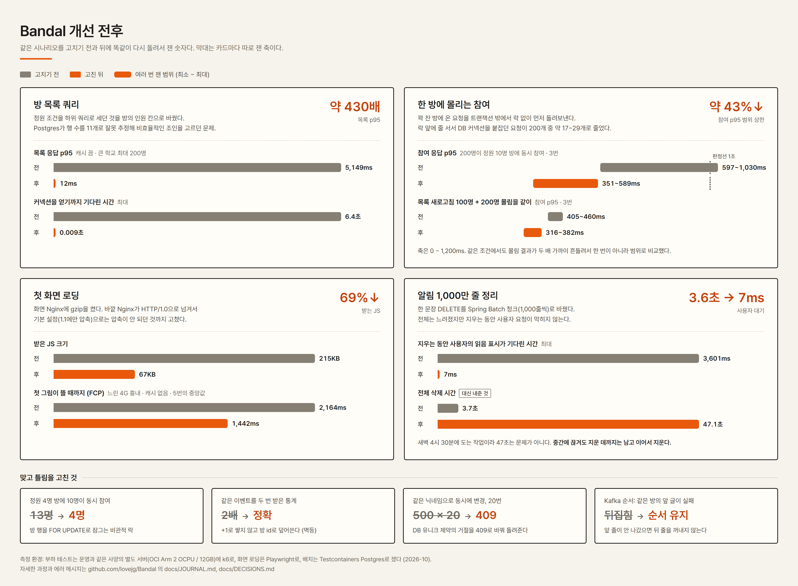](docs/images/perf/improvements.png)

| 무엇을 | 전 | 후 | 어떻게 |
| --- | --- | --- | --- |
| 방 목록 p95 (캐시 끔, 240명) | 5,149ms | 12ms | 하위 쿼리로 세던 정원 조건을 방의 인원 칸으로 |
| 한 방에 200명이 참여, 참여 p95 (3번) | 597~1,030ms | 351~589ms | 꽉 찬 방 요청을 락 앞에서 먼저 돌려보내기 |
| 첫 화면에서 받는 JS / FCP | 215KB / 2,164ms | 67KB / 1,442ms | 화면 Nginx gzip, HTTP/1.0 조건까지 |
| 알림 1,000만 줄 정리 중 읽음 표시 대기 | 3,601ms | 7ms | 한 문장 삭제를 1,000줄씩 나누는 Batch Job으로 (전체 시간은 3.7초 → 47.1초로 늘었다) |

## 어떻게 돌아가나

```
모집중 -> 마감 -> 정산중 -> 주문완료 -> 배달완료
  |        |        |
  +--------+--------+--> 취소 (정산중에 취소되면 환불이 끝날 때까지 추적한다)
```

- 학교 메일로만 가입한다. 가입이 곧 소속 확인이고, 다른 학교의 방은 보이지 않는다.
- 배달비는 인원수로 똑같이 나눈다. 내가 낼 돈 = 내 메뉴 합계 + 배달비 / 인원. 나누어떨어지지 않는 나머지는 방장이 낸다.
- 송금이 주문보다 먼저다. 참여자가 방장 계좌로 보내고 "보냈어요"를 누르면, 방장이 확인한 뒤 결제한다.
  앱은 돈을 직접 옮기지 않는다. 대신 누가 언제 보냈고 확인했는지가 기록으로 남는다.
- 방장이 사라져도 방이 멈추지 않는다. 스케줄러가 오래 멈춘 방을 마감, 취소, 배달완료로 넘긴다.
- 방이 끝나면 신뢰도 점수가 움직인다. 배달완료는 +2, 주문 안 한 방장은 -15, 안 보낸 참여자는 -5. 30점 아래로 떨어지면 방을 못 연다.
- 방을 열 때 음식 카테고리를 1~3개 고르고, 목록은 카테고리로 거를 수 있다.

## 화면

방 하나를 모집부터 주문까지 진행하며 찍었다. 방장은 야식요정, 참여자는 마라중독이다. 계좌번호는 시연용 가짜 번호다.

### 가입

<table>
  <tr>
    <td valign="top" width="50%">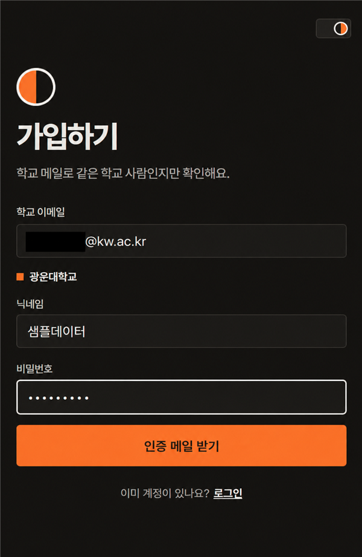<br>학교 메일을 넣으면 어느 학교인지 바로 보인다. 목록에 없는 도메인은 가입이 안 된다.</td>
    <td valign="top" width="50%">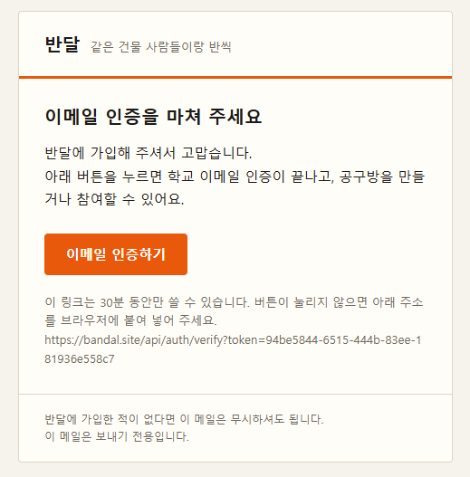<br>인증 메일. 링크를 누르기 전에는 구경만 하고 방을 열거나 들어갈 수 없다.</td>
  </tr>
</table>

### 방 찾기, 방 열기

<table>
  <tr>
    <td valign="top" width="50%">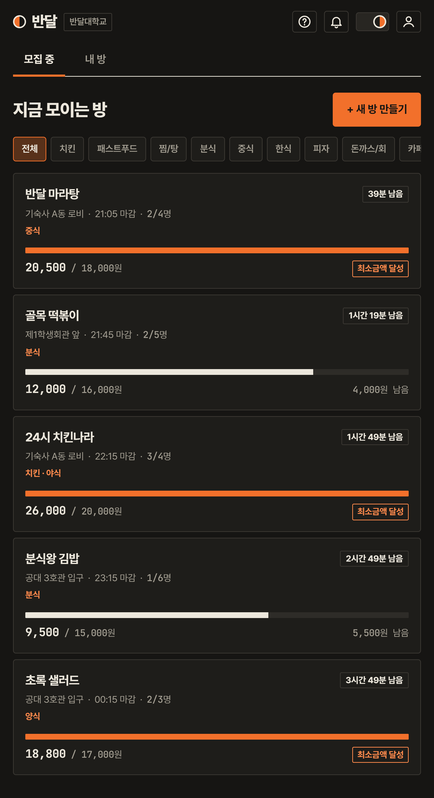<br>같은 학교의 모집중 방만 보인다. 막대는 방 전체 메뉴가 최소금액을 얼마나 채웠는지다. 위의 카테고리로 거를 수 있다.</td>
    <td valign="top" width="50%">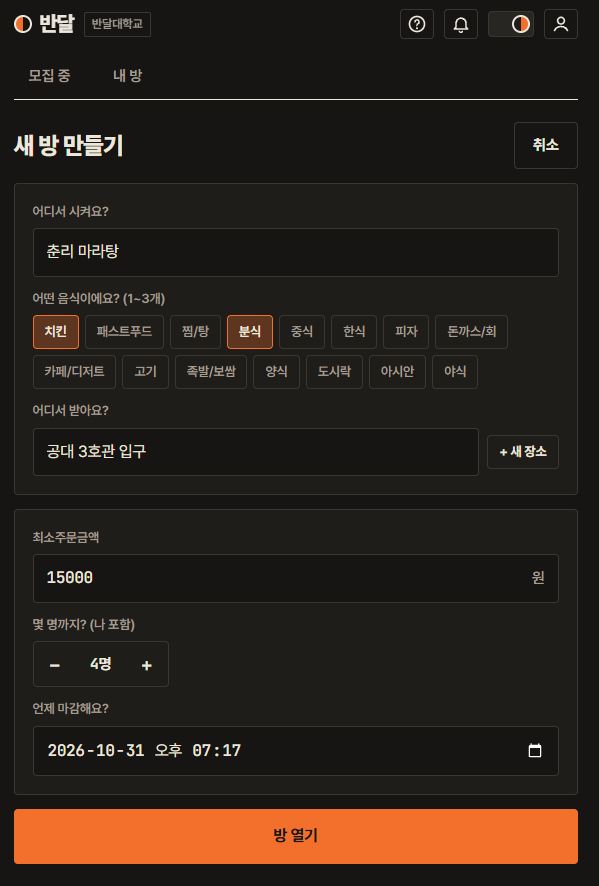<br>가게, 음식 종류(1~3개), 수령 장소, 최소금액, 인원, 마감 시각을 정해 연다.</td>
  </tr>
</table>

### 모집중

<table>
  <tr>
    <th>방장</th>
    <th>참여자</th>
  </tr>
  <tr>
    <td valign="top" width="50%">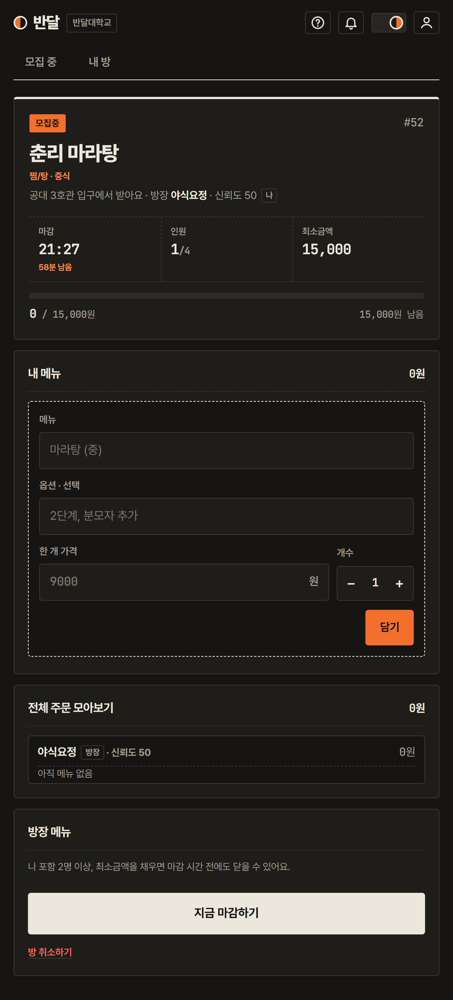<br>방장도 자기 메뉴를 담는다. 아래 "전체 주문 모아보기"에 사람별 메뉴가 모인다.</td>
    <td valign="top" width="50%">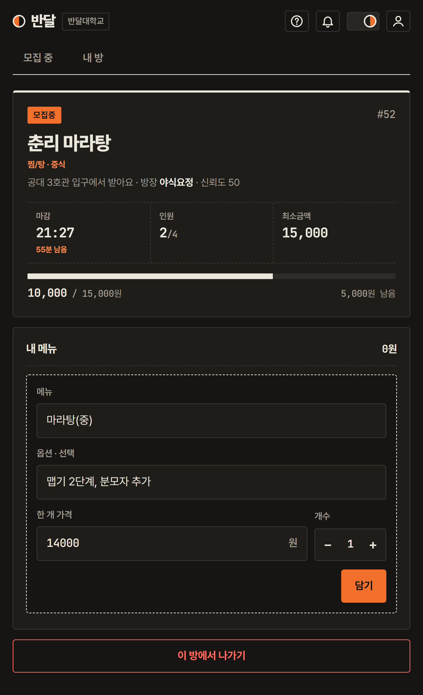<br>참여자는 자기 메뉴만 담고 고친다. 방장 닉네임 옆에 신뢰도가 보인다.</td>
  </tr>
</table>

### 마감

<table>
  <tr>
    <td valign="top" width="50%">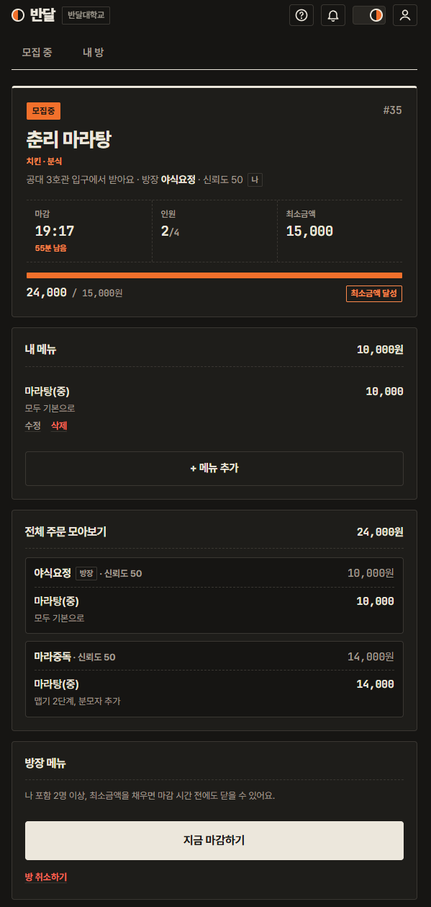<br>2명 이상 모이고 최소금액을 넘기면 마감 시각 전에도 닫을 수 있다.</td>
    <td valign="top" width="50%">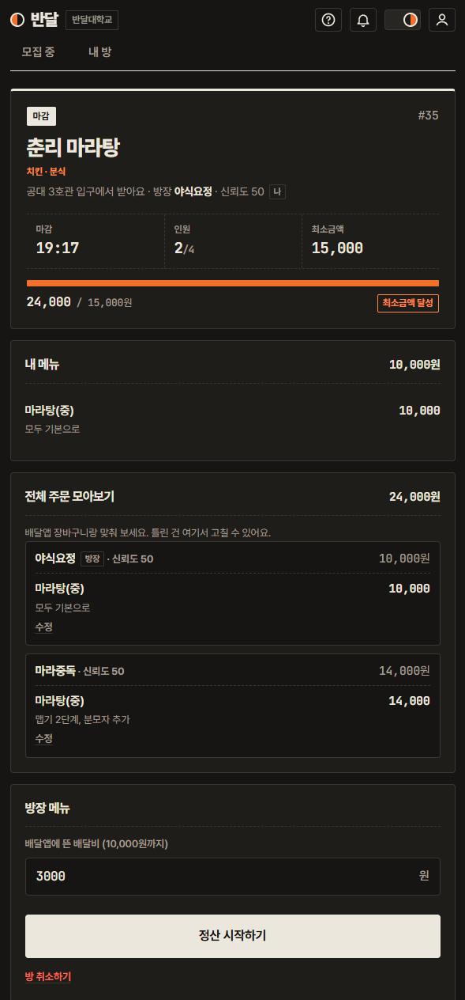<br>마감 뒤에는 방장이 배달앱 장바구니와 맞춰 보고 틀린 메뉴를 고칠 수 있다. 배달앱에 뜬 배달비를 넣으면 정산이 시작된다.</td>
  </tr>
</table>

### 정산중

<table>
  <tr>
    <th>참여자</th>
    <th>방장</th>
  </tr>
  <tr>
    <td valign="top" width="50%">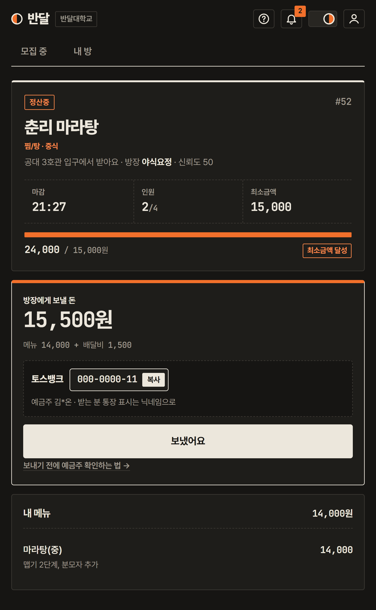<br>낼 돈은 15,500원. 내 메뉴 14,000원에 배달비 3,000원을 둘이 나눈 1,500원을 더했다. 방장 계좌로 직접 보내고 "보냈어요"를 누른다.</td>
    <td valign="top" width="50%">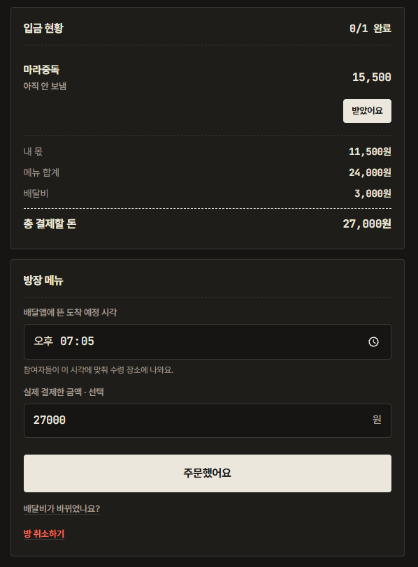<br>방장은 누가 보냈고 누가 아직인지 본다. 통장에 들어온 걸 확인하면 "받았어요"를 누른다.</td>
  </tr>
</table>

### 주문

<table>
  <tr>
    <td valign="top" width="50%">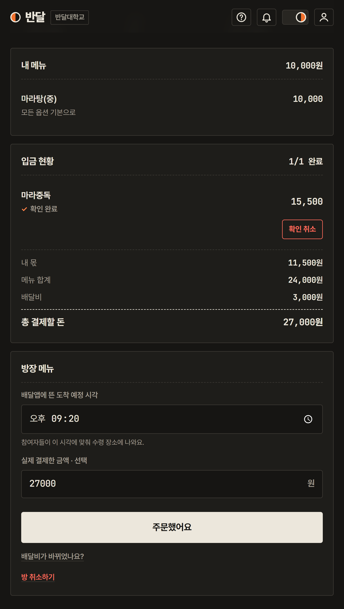<br>전원의 입금이 확인돼야 주문완료로 넘어간다. 방장은 배달앱으로 결제하고 앱에 뜬 도착 예정 시각을 적는다.</td>
    <td valign="top" width="50%">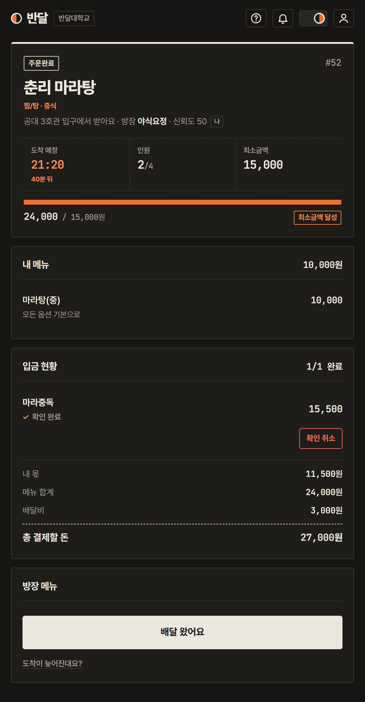<br>주문 뒤에는 마감 시각 자리에 도착 예정이 뜬다. 배달이 오면 방장이 "배달 왔어요"로 끝낸다.</td>
  </tr>
</table>

### 알림

<table>
  <tr>
    <td valign="top" width="50%">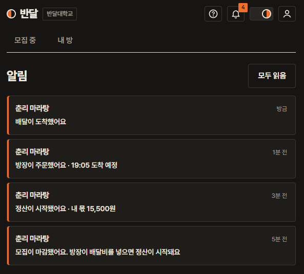<br>상태가 바뀔 때마다 참여자에게 알림이 간다. 종에 안 읽은 개수가 뜬다.</td>
    <td width="50%"></td>
  </tr>
</table>

## 기술 스택

| | 쓴 것 | 왜 |
| --- | --- | --- |
| 백엔드 | Spring Boot 4.1, Java 21, JPA | |
| DB | PostgreSQL 17, Flyway | 금액 계산에 정확한 숫자 타입이 필요하다. 테이블은 마이그레이션 파일로만 바꾼다 |
| 캐시, 토큰 | Redis | 리프레시 토큰, 메일 인증 토큰, 학교별 방 목록 첫 페이지 캐시(10초) |
| 이벤트 | Kafka (KRaft 한 대) | 방 상태가 바뀌면 알림, 통계, 신뢰도가 서로 모른 채 따로 읽는다. 통계는 되감아서 다시 셀 수 있어야 했다 |
| 배치 | Spring Batch | 읽은 지 30일 지난 알림을 매일 새벽에 1,000개씩 나눠 지운다 |
| 화면 | React 18, Vite, TypeScript | |
| 배포 | Oracle Cloud Arm 서버 한 대, Docker Compose, GitHub Actions, GHCR | 무료 한도 안에서 계속 둘 수 있는 곳 |
| 관측 | Prometheus, Grafana, Loki, Alloy, k6 | 문제를 숫자로 재현하고, 고친 뒤 같은 시나리오로 다시 잰다 |
| 메일 | Resend (운영), Mailpit (로컬) | |

## 구조

[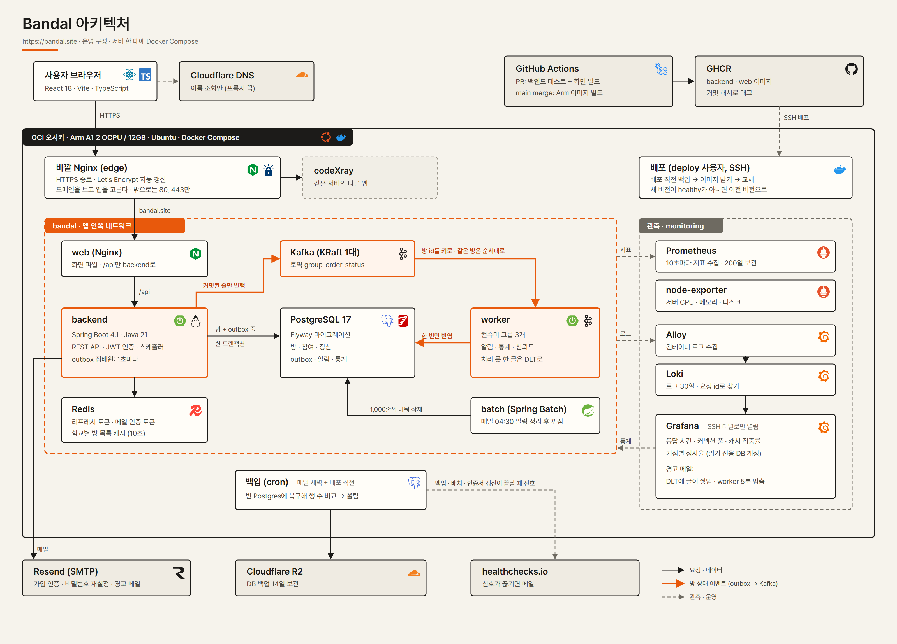](docs/images/architecture.png)

- 밖으로 열린 포트는 바깥 Nginx의 80, 443뿐이다. DB와 backend는 앱 안쪽 네트워크에만 붙어 있다.
- 방 상태를 바꾸는 트랜잭션은 Kafka에 직접 쓰지 않는다. 같은 트랜잭션에서 outbox 표에 한 줄을 남기고, 커밋된 줄만 집배원이 Kafka로 보낸다.
  DB는 바뀌었는데 이벤트는 사라지는 일, 롤백됐는데 이벤트만 나가는 일이 없다.
- worker는 웹과 다른 컨테이너다. 컨슈머 그룹 셋(알림, 통계, 신뢰도)이 같은 글을 따로 읽는다. 컨슈머가 느려지거나 죽어도 방 기능은 그대로 돈다.
  운영과 같은 구성으로 worker를 내렸다가 올려 보니 15초 만에 밀린 글을 다 따라잡았다.

## 측정 방법

"버틴다"를 감으로 말하지 않으려고, 무엇을 어디서 어떻게 잴지를 측정 전에 먼저 정했다([ADR-074](docs/DECISIONS.md)).

**어디서**
- 운영 서버와 같은 사양(Oracle Cloud Arm 2 OCPU / 12GB, 같은 compose와 이미지)의 테스트 서버를 따로 띄웠다. 운영 서버에 부하를 걸면 실제 사용자가 느려지고 데이터가 섞인다.
- k6는 운영 서버에서 CPU 1개로 제한해, 같은 데이터센터의 사설 IP로 걸었다. 받는 서버와 같은 기계에서 돌리면 k6가 CPU를 나눠 먹고, 집에서 걸면 인터넷 지연이 섞인다.
- 데이터는 학교마다 규모를 다르게 넣었다. 큰 학교(사용자 2,000, 모집중 방 300)와 작은 학교(200, 20) 외 11곳, 합계 사용자 2,530, 방 4,127, 참여 15,775. 측정마다 같은 데이터로 다시 시작했다.

**시나리오**
- A. 한 방에 몰림: 마감 직전 단톡방에 링크가 돌아 200명이 정원 10명 방에 동시에 참여한다. 정원이 지켜지는지도 같이 본다.
- B. 목록 새로고침: 큰 학교 50 → 100 → 200명, 작은 학교 10 → 20 → 40명이 방 목록을 부른다. 캐시를 켠 것과 끈 것을 비교한다.
- C. A와 B를 같이: 목록 100명이 도는 중에 200명이 한 방에 몰린다. 상관없는 요청까지 느려지는지 본다.

**판정선은 결과를 보기 전에 정했다**
방 목록 p95 300ms, 참여 p95 1초(락 대기열이라 여유를 준다), 에러율 1% 미만. 결과를 본 뒤에 선을 그으면 결과에 맞춰 긋게 된다.

**숫자를 읽을 때 지킨 것**
- 평균이 아니라 p95, p99를 본다. 40명 중 5명이 6초를 기다려도 평균은 0.8초로 나온다.
- 같은 조건에서도 A의 참여 p95가 537~1,235ms(목록을 고치기 전, 4번)로 두 배 넘게 흔들렸다. 그래서 전후 비교는 한 번이 아니라 여러 번 잰 범위로 한다.
- 본문의 숫자는 k6(사용자 쪽)가 잰 값이다. 아래 Grafana 사진은 서버 안에서 잰 값이라 조금 다르다. 서버 안 시간에는 Tomcat 앞에서 기다린 시간이 빠진다.
- 10초마다 찍는 순간값(커넥션 대기 수 등)은 1초 안에 끝나는 몰림을 놓친다. 몰림은 "최근 구간의 최대값"을 들고 있는 지표로 본다([NOTES](docs/NOTES.md)).

## 성능 개선

### 1. 방 목록: 캐시를 끄자 보인 쿼리 문제

[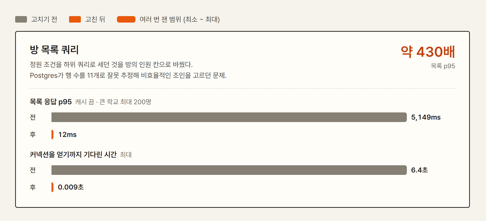](docs/images/perf/card-1-list-query.png)

**증상**
캐시를 켠 B에서는 목록 p95가 7.6ms로 판정선 한참 아래였다. 캐시 적중률은 97~99%였다. 목록이 빠른 게 쿼리 덕인지 캐시 덕인지 알 수 없어서 캐시를 끄고 다시 쟀다.

| 캐시 끈 B, 단계 | 목록 p95 | 초당 목록 | 커넥션 얻는 시간 최대 | 서버 CPU | backend CPU |
| --- | --- | --- | --- | --- | --- |
| 60명 | 0.47~0.53초 | 35 | 0.27~0.41초 | 95% | 9~14% |
| 120명 | 1.9~2.2초 | 39~40 | 1.6~1.8초 | 100% | 7% |
| 240명 | 5.3~5.7초 | 40 | 5.2~6.4초 | 100% | 7% |

- 60명에서 이미 판정선(300ms)을 넘었다. 처리량은 초당 40건에서 더 오르지 않았다. 사용자가 늘면 줄만 길어졌다.
- 서버 CPU는 100%인데 backend는 7%였다. CPU를 쓰는 건 Postgres였다. 목록 쿼리가 커넥션 10개를 다 잡아서 나머지 요청은 커넥션을 최대 6.4초 기다렸다.

<table>
  <tr>
    <th>고치기 전 (캐시 끔, 10/21 17:47~17:53)</th>
    <th>고친 뒤 (캐시 끔, 10/21 21:23~21:26)</th>
  </tr>
  <tr>
    <td valign="top" width="50%">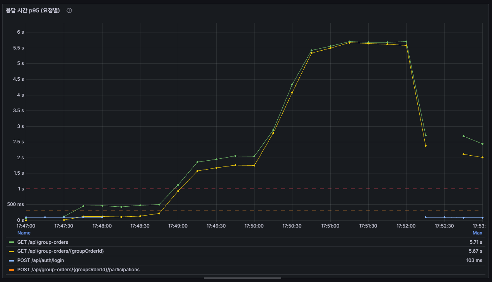<br>응답 시간 p95. 목록 최대 5.71s</td>
    <td valign="top" width="50%">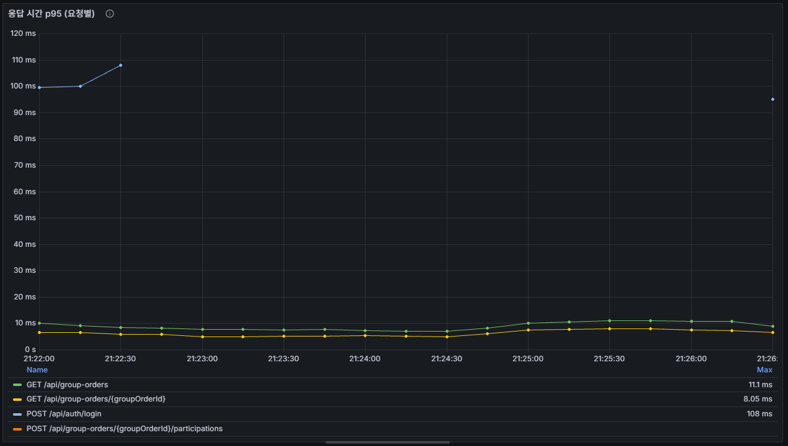<br>목록 최대 11.1ms</td>
  </tr>
  <tr>
    <td valign="top">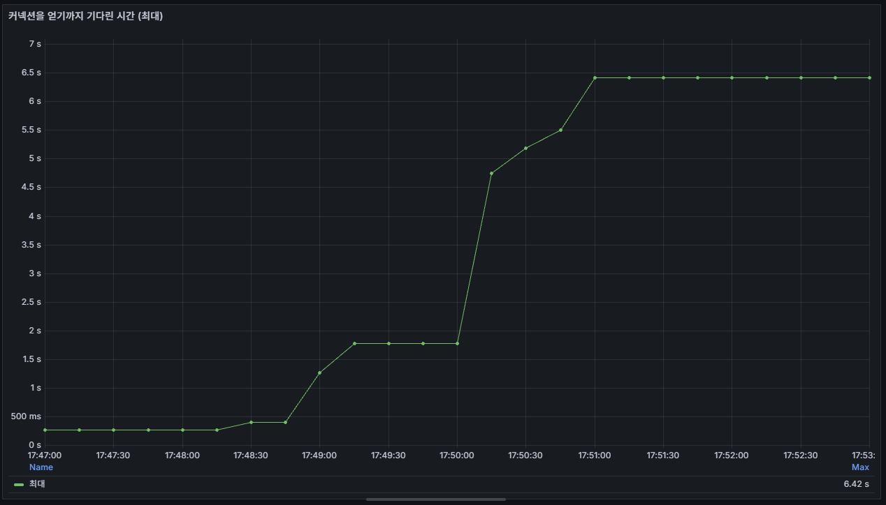<br>커넥션을 얻기까지 기다린 시간(최대) 6.42s</td>
    <td valign="top">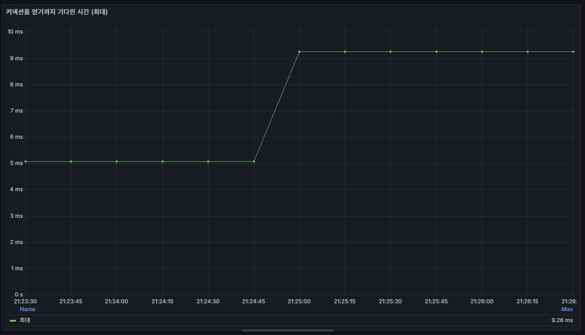<br>9.26ms</td>
  </tr>
  <tr>
    <td valign="top">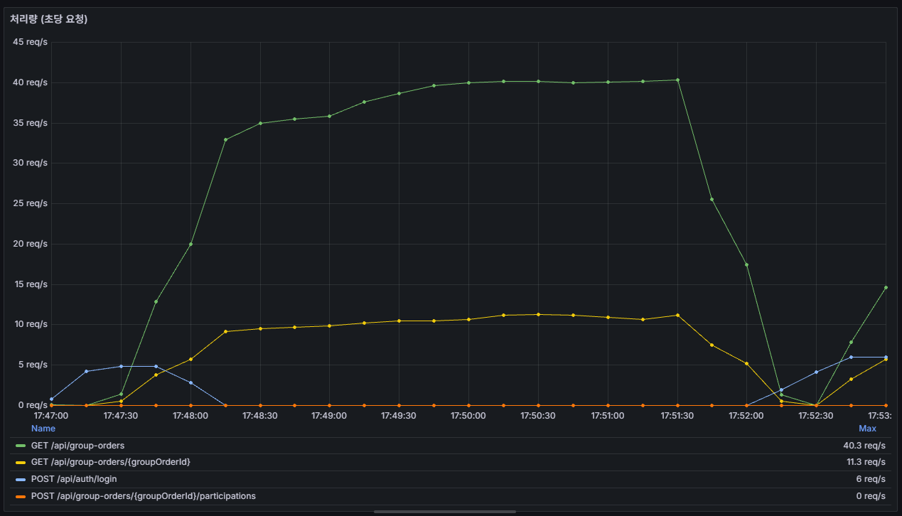<br>처리량. 목록 초당 40.3건에서 막힘</td>
    <td valign="top">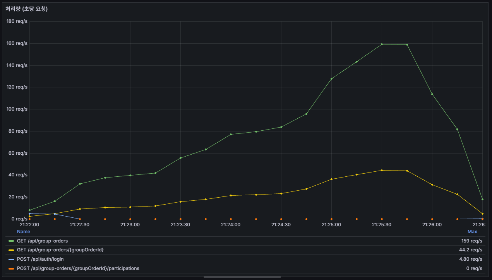<br>초당 159건(부하가 요청한 만큼)</td>
  </tr>
</table>

전후 사진의 세로축 단위가 다르다(초와 ms). 높이가 아니라 범례의 숫자로 비교한다.

**원인: 인덱스가 아니었다**
처음에는 상태, 마감 시각 열에 인덱스가 없어서라고 예상했다. `EXPLAIN ANALYZE`로 보니 아니었다.
- 방 표 전체 훑기는 2ms였다. 4천 행이라 인덱스가 없어도 싸다.
- Postgres가 조건에 맞는 방을 **11개로 추정했는데 실제는 375개**였다. 상태와 마감 시각을 서로 상관없는 조건으로 보고 곱했고(실제로는 같은 집합), 짐작할 수 없는 "하위 쿼리 < 정원"에 정해진 비율 1/3을 곱했다.
- 적게 추정한 탓에 방장을 붙이는 조인을 "사용자 2,530행 × 방 300개를 하나씩 비교"하는 방식으로 골랐다. 비교 약 76만 번(조인 조건으로 걸러 낸 행 758,700)에 쿼리 한 번이 101ms였다.

**해결**
방 표에는 이미 참여할 때마다 락 안에서 함께 바뀌는 인원 칸(`participant_count`)이 있었다. 목록 쿼리만 그 전의 모양으로 남아 있었다.
정원 조건을 `(SELECT COUNT(p) ...) < capacity`에서 `participantCount < capacity`로 바꿨다. 같은 데이터에서 쿼리 한 번이 101ms → 1.8ms가 됐다.
바꾸기 전에 그 숫자를 믿어도 되는지 확인했다. 테스트 서버의 모든 방에서 인원 칸과 실제 참여 행 수가 다른 방은 0개였다.

**결과 (캐시 끔 B, 같은 순서와 데이터)**

| | 고치기 전 | 고친 뒤 |
| --- | --- | --- |
| 목록 p95 (큰 학교 / 작은 학교) | 5,149ms / 5,038ms | **12.0ms / 10.7ms** |
| 방 보기 p95 | 4,883ms | 9.0ms |
| 240명 단계 초당 목록 / 서버 CPU | 40건(천장) / 100% | 160건 / 47% |
| 목록 쿼리 평균 / 커넥션 얻는 시간 최대 | 0.24초 / 6.4초 | 0.002초 / 0.009초 |
| 캐시 켬 C, 목록 p99 (측정 전체, 3번) | 99~186ms | 39~60ms |

**캐시가 가리고 있던 것**

<table>
  <tr>
    <th>같은 옛 쿼리, 캐시 켬 (10/21 17:11~17:15)</th>
    <th>캐시 적중률</th>
  </tr>
  <tr>
    <td valign="top" width="50%">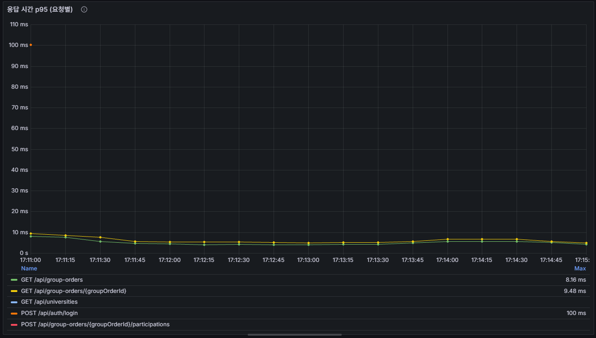<br>목록 p95 최대 8.16ms. 캐시를 끈 같은 쿼리는 위의 5.71s</td>
    <td valign="top" width="50%">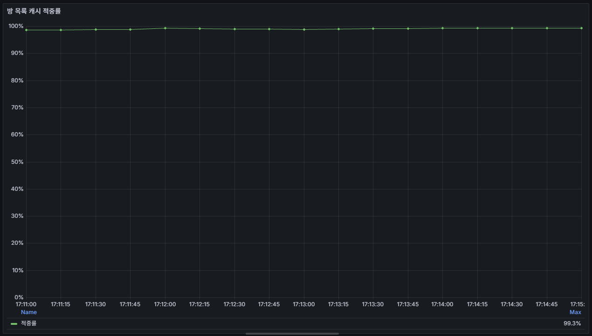<br>99.3%(Grafana 최대). k6 측정 구간 전체로는 97~99%</td>
  </tr>
</table>

캐시를 켠 측정만 했으면 이 문제를 몰랐다. 그런데 캐시가 비는 순간은 실제로 온다. 참여가 성공할 때마다 그 학교 목록 캐시를 지우고, TTL도 10초다.
고치기 전 첫 C 측정에서는 200명이 몰린 20초 구간에 상관없는 목록 요청의 p99가 7ms → 250~307ms로 튀었다(Prometheus, 15초 창. 위 표의 99~186ms는 측정 전체의 p99다). 캐시가 지워진 순간 목록이 비싼 쿼리로 DB에 갔기 때문이다.
고친 뒤로 캐시는 "버티게 해 주는 것"에서 "더 아끼는 것"이 됐다.

**남은 것**
추정은 고친 뒤에도 11개로 틀린다. 비싼 하위 쿼리가 빠지면서 조인 비교가 뒤집힌 것이라, 데이터 모양이 바뀌면 계획이 다시 나빠질 수 있다. 데이터가 커지면 실행 계획을 다시 본다.

[트러블슈팅 기록](docs/JOURNAL.md#2026-10-21-캐시를-끄자-방-목록-p95가-5초가-됐다-원인은-인덱스가-아니라-하위-쿼리의-행-수-추정이었다) · 결정: [DECISIONS](docs/DECISIONS.md) ADR-074, ADR-076

### 2. 참여 몰림: 꽉 찬 방 요청을 락 앞에서 먼저 돌려보내기

[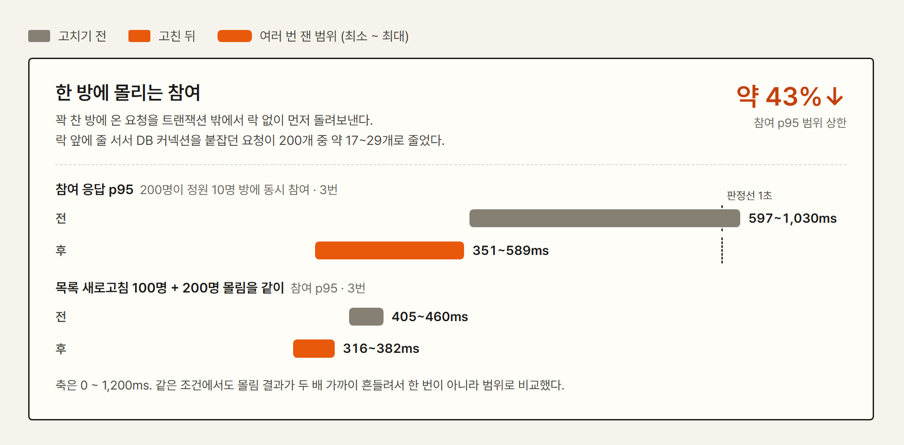](docs/images/perf/card-2-join-rush.png)

**증상**
목록을 고친 뒤에도 A(200명이 정원 10명 방에 동시 참여)의 참여 p95는 597~1,030ms였다. 3번 중 한 번은 판정선(1초)을 넘었다.
정원은 비관적 락이 지킨다. 참여는 방 행을 `FOR UPDATE`로 잠그며 읽고, 같은 방의 요청은 그 앞에 줄을 선다.

<table>
  <tr>
    <th>DB 커넥션 풀 (고치기 전, 10/21 21:01~21:07)</th>
    <th>락 잡는 조회가 1분에 불린 횟수 (고치기 전)</th>
  </tr>
  <tr>
    <td valign="top" width="50%">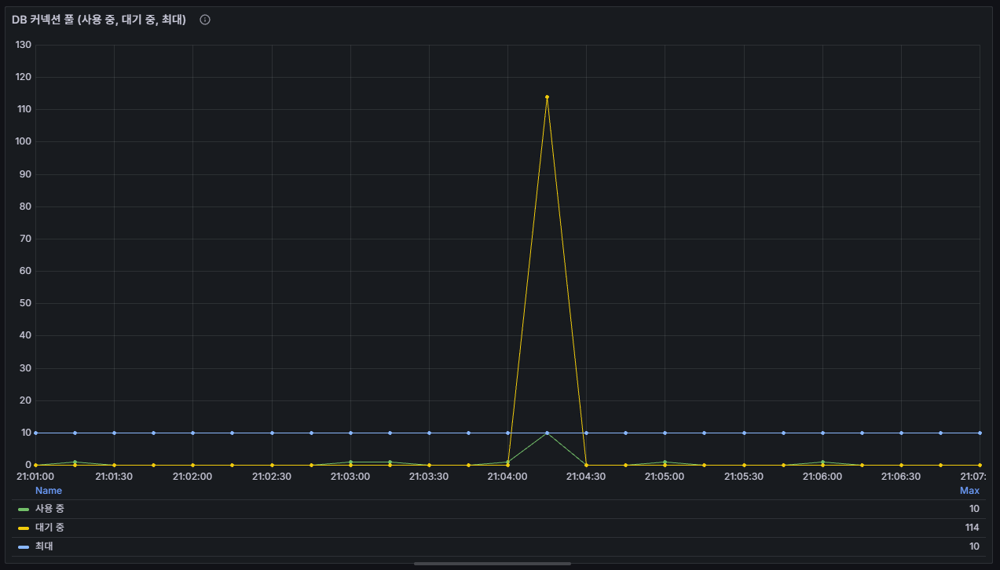<br>커넥션 10개가 모두 사용 중이고, 114개 요청이 커넥션을 기다린 순간</td>
    <td valign="top" width="50%">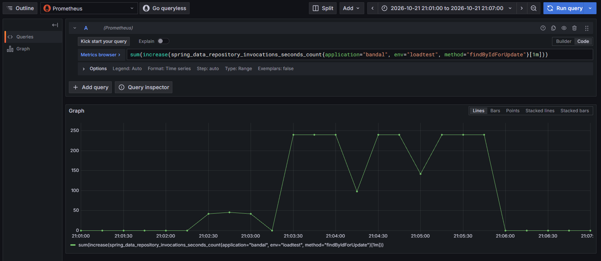<br>측정마다 약 240(그래프 값). 실제로는 200건 전부가 락까지 갔다</td>
  </tr>
</table>

**원인**
9자리는 앞의 몇십 명 안에서 찬다. 그런데 이미 꽉 찬 방에 온 나머지 요청도 전부 트랜잭션을 열고, 커넥션을 쥔 채 락 앞에 줄을 섰다. "정원이 다 찼습니다"를 듣기 위해 줄을 선 셈이다.
커넥션 10개가 락 대기에 묶이자, 뒤에 온 요청은 커넥션 자체를 못 받았다.

**해결**
컨트롤러와 참여 서비스 사이에 트랜잭션 없는 문지기(`ParticipationGate`)를 뒀다. 방을 락 없이 읽어 인원이 정원 이상이면 바로 409로 돌려보낸다.
자리가 남아 보이면 지금처럼 서비스로 넘기고, 정원은 여전히 락 안의 `addParticipant`가 지킨다. 문지기는 줄을 줄일 뿐이고, 정답을 정하는 건 계속 락이다.

처음에는 같은 트랜잭션 안에서 미리 보기를 했다가 정원 4명 방에 13명이 들어갔다. JPA가 처음 읽은 방 객체를 기억해 두었다가, 잠그며 다시 읽어도 그 옛 객체를 돌려줬기 때문이다([동시성과 정합성](#동시성과-정합성)). 그래서 문지기를 트랜잭션 밖의 별도 클래스로 뒀다.

**예상이 틀렸다**
미리 보기는 "효과 없음을 확인할 첫 단계"로 넣었다. 200명이 같은 순간에 오면 모두 0명을 읽고 통과할 거라고 봤다.
실제로는 요청이 서버에 수백 ms에 걸쳐 퍼져 닿고, 락 안의 처리는 몇 ms라 9자리가 금방 찬다. 그 뒤에 닿은 요청은 미리 보기에서 꽉 찬 것을 봤다.

**결과 (같은 순서와 조건, 캐시 켬, 3번씩)**

<table>
  <tr>
    <th>락 잡는 조회 횟수, 고치기 전 (10/21 21:01~21:07)</th>
    <th>고친 뒤 (10/22 15:33~15:39)</th>
  </tr>
  <tr>
    <td valign="top" width="50%"><br>측정마다 약 240</td>
    <td valign="top" width="50%">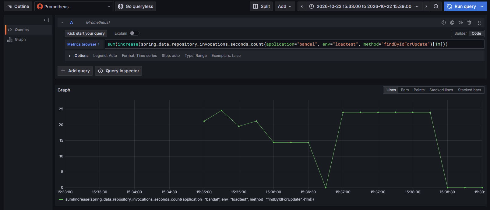<br>측정마다 약 14~25</td>
  </tr>
</table>

그래프 값은 Prometheus `increase()`의 어림이라 실제보다 크게 나온다. 맨 앞의 작은 봉우리(약 40)는 40명 워밍업이다. 세로축이 250과 25로 열 배 다르다.

| | 고치기 전 | 고친 뒤 |
| --- | --- | --- |
| A 200명, 참여 p95 | 597~1,030ms | **351~589ms** |
| A 200명, 방 락까지 간 요청 | 200(전부) | **약 17~29** |
| C, 참여 p95 | 405~460ms | 316~382ms |
| C, 목록 p99 / 방 보기 p99 | 39~60ms / 139~212ms | 31~57ms / 122~197ms |

**남은 한계**

<table>
  <tr>
    <th>커넥션을 얻기까지 기다린 시간(최대), 고치기 전</th>
    <th>고친 뒤</th>
  </tr>
  <tr>
    <td valign="top" width="50%">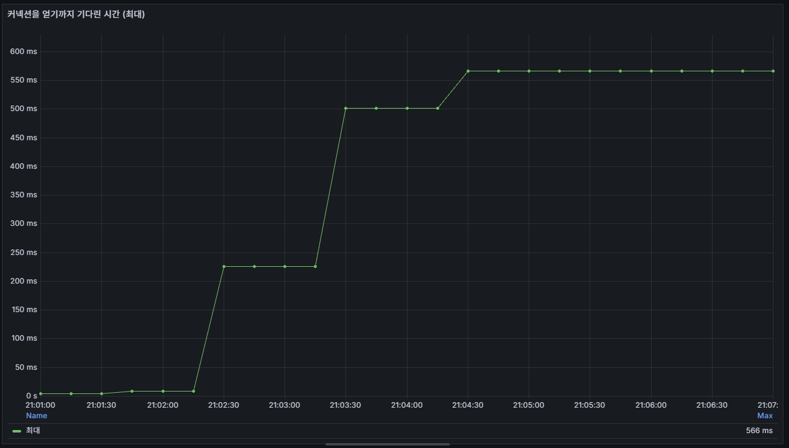<br>최대 566ms</td>
    <td valign="top" width="50%">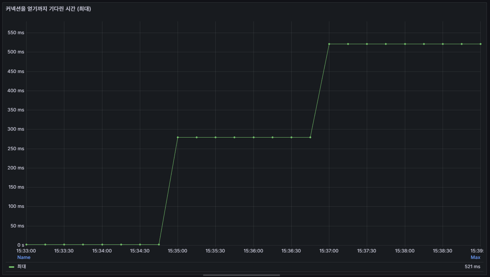<br>최대 521ms. 거의 그대로다</td>
  </tr>
</table>

문지기도 인원을 보려고 DB를 한 번 읽어서 커넥션을 잠깐 빌린다. 그래서 200개가 몰리는 첫 순간에 커넥션 10개를 얻으려는 대기는 남는다. 바뀐 건 락 앞에 줄 서는 요청 수다.
500명, 1,000명에서는 참여 p95가 1,161ms, 1,112ms로 1초를 넘었다. 락까지 간 요청은 약 23, 약 12로 여전히 적었다. 서버 안 처리 시간은 최대 0.62~0.71초이고 그중 커넥션 얻기가 최대 0.58~0.60초였다. k6가 본 나머지 0.5초쯤은 Tomcat 스레드(200개)를 기다린 몫으로 본다. 스레드 게이지는 몰림 순간을 못 잡아서 직접 확인하지는 못했다.

**보류한 대안**
- Redis 번호표(남은 자리 수만큼 표를 나눠 주고 표를 받은 요청만 락으로): 덜어 줄 수 있는 건 커넥션 몫(최대 0.6초)뿐이고 Tomcat 몫은 그대로다. 대신 Redis와 DB 숫자 맞추기, 표 수명, 표 돌려주기 시점을 떠안는다. 한 방에 1초 안에 500명이 누르는 건 학교 하나의 배달 모집에서 생각하기 어려운 부하라 보류했다. 운영에서 몰림 때 커넥션 대기 최대가 0.5초를 넘는 일이 반복되면 다시 꺼낸다.
- Redis 분산 락: 잠글 대상이 모두 한 DB의 행이라 DB 락으로 충분했다. DB 밖에 잠금을 두면 Redis가 죽었을 때 참여가 막힌다.
- 커넥션 풀, Tomcat 스레드 늘리기: 500명 이상에서만 보이는 몫이라 지금은 손대지 않았다.

[트러블슈팅 기록](docs/JOURNAL.md#2026-10-22-락-전에-인원을-미리-보자-정원-4명-방에-13명이-들어가고-방장의-취소가-사라졌다) · 결정: [DECISIONS](docs/DECISIONS.md) ADR-077, ADR-078

### 3. 첫 화면 로딩: 꺼져 있던 압축

[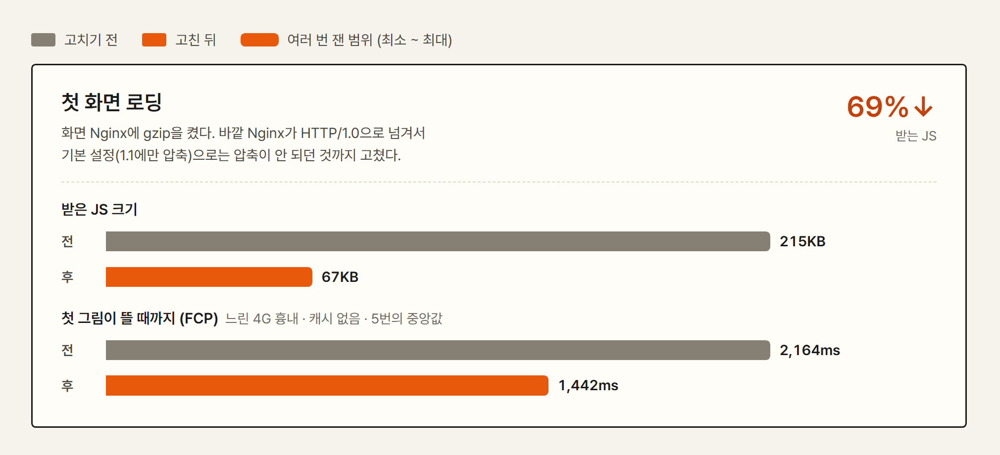](docs/images/perf/card-3-first-load.png)

**증상**
bandal.site는 JS 215KB, CSS 21KB를 압축 없이 보내고 있었다. 정적 파일의 `Cache-Control` 헤더도 두 줄 나갔다(`expires`와 `add_header`를 같이 써서).

**원인**
화면 Nginx에 gzip이 꺼져 있었다. 그리고 켜는 것만으로는 운영에서 압축이 안 되는 함정이 있다. 바깥 Nginx는 안쪽으로 HTTP/1.0으로 넘기는데(`proxy_http_version` 기본값), gzip은 기본으로 HTTP/1.1 요청에만 압축한다(`gzip_http_version 1.1`).
브라우저가 화면 컨테이너에 직접 붙는 로컬에서는 드러나지 않는다. 같은 서버의 다른 앱에서 gzip을 켜고 배포했다가 운영에서만 압축이 빠지는 걸 먼저 겪었다. 그래서 Bandal에서는 켤 때 1.0 조건까지 같이 걸었다.

**해결**
화면 Nginx에 `gzip on`과 `gzip_http_version 1.0`을 같이 걸었다. JS, CSS, JSON, SVG를 압축하고, 1KB 미만은 그대로 둔다. `/assets/`의 캐시 헤더는 `public, max-age=31536000, immutable` 한 줄로 정리했다.

**결과** (Playwright, 캐시 없음, 느린 4G 흉내: 지연 150ms · 1.6Mbps, CPU 4배 느리게, 5번의 중앙값)

| | 받은 JS | FCP |
| --- | --- | --- |
| 운영, 고치기 전 | 215KB | 2,164ms |
| 운영, 배포 뒤 | 67KB | 1,442ms |

**버린 대안**
바깥 Nginx에서 압축하거나 HTTP/1.1로 넘기면 두 앱이 한 번에 해결된다. 하지만 바깥 Nginx는 배포 워크플로가 올리지 않아 손으로 적용해야 하고, 앱의 응답 성질이 앱 저장소 밖의 설정에 기대게 된다.

결정: [DECISIONS](docs/DECISIONS.md) ADR-088

### 4. 알림 1,000만 줄 정리: 빠른 것보다 막지 않는 것

[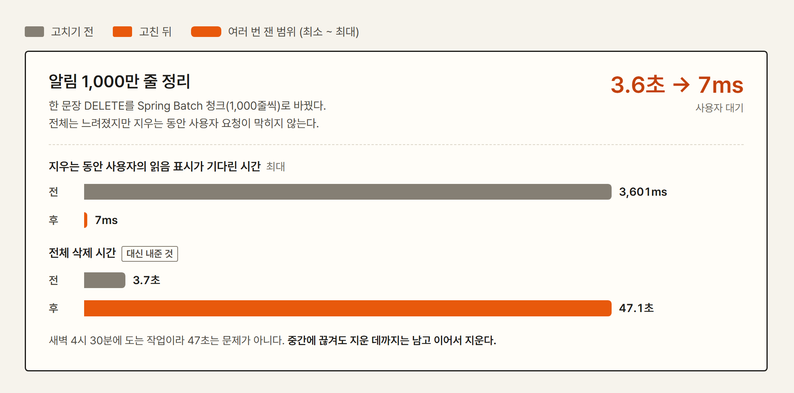](docs/images/perf/card-4-batch.png)

알림은 상태가 바뀔 때마다 참여자 수만큼 쌓이고 지우는 곳이 없었다. 읽은 지 30일 지난 알림을 지우기로 하고, 먼저 한 문장 DELETE로 깨뜨려 봤다.

**측정** (Testcontainers Postgres, 지울 줄 + 남길 줄 20만. 지우는 동안 다른 연결이 지울 줄의 읽음 표시를 계속 보냄)

| | 한 문장, 1,000만 | 청크 Job(1,000줄씩), 1,000만 |
| --- | --- | --- |
| 걸린 시간 | 3.7초 | 47.1초 (커밋 10,000번) |
| 지울 줄의 읽음 표시가 기다린 시간 | 3,601ms | 가장 긴 것 7ms (1,037번 보냄, 50ms 넘은 것 0) |
| WAL | 1,725MB를 3.7초에 | 1,759MB를 47초에 걸쳐 |
| 절반쯤에서 끊기면 | 전부 롤백, 처음부터 | 500.1만 줄 남음, 다시 돌리면 그것만 읽고 22.2초에 끝 |

**트레이드오프**
빨라진 게 아니다. 전체 시간은 열세 배쯤 늘었다. 그 대신 지우는 동안 어떤 요청도 7ms 넘게 기다리지 않고, 끊겨도 지운 데까지는 남고 이어서 지운다.
Spring Batch를 고른 큰 이유도 속도가 아니라 실행 기록이다. 시작, 끝, 처리한 줄 수, 성공 여부가 메타 표에 남고, 같은 날짜로 두 번 도는 것을 막는다.

**버그: offset Reader가 절반만 지우고 COMPLETED**
처음 만든 쪽(offset) 방식 Reader는 2,500줄 중 1,500줄만 지우고 성공으로 끝났다. 지운 만큼 뒤 줄이 앞으로 당겨져서, 다음 쪽을 읽을 때 건너뛴 것이다.
"마지막 id 다음부터" 읽는 키셋 Reader(`JdbcPagingItemReader`, 정렬 키 id)로 바꿨다. 건너뛰지 않고, 마지막 id가 실행 기록에 남아 이어서 하기도 된다.

**운영**
매일 새벽 4시 30분 cron이 batch 컨테이너를 띄운다. 웹 서버 없이 Job 하나를 돌리고 스스로 꺼지며, 결과를 종료 코드로 낸다. 실패하거나 아예 안 돌면 healthchecks.io가 메일을 보낸다.

[트러블슈팅 기록](docs/JOURNAL.md#2026-10-28-알림-100만-줄을-한-문장으로-지웠더니-03초에-끝났다-1000만-줄에서-읽음-표시가-35초-기다렸고-wal이-17gb-쏟아졌다) · 결정: [DECISIONS](docs/DECISIONS.md) ADR-084

## 동시성과 정합성

순진한 버전을 먼저 만들어 실제로 깨지는 걸 보고 고쳤다. 전부 [JOURNAL](docs/JOURNAL.md)에 에러 메시지와 함께 남아 있다.

[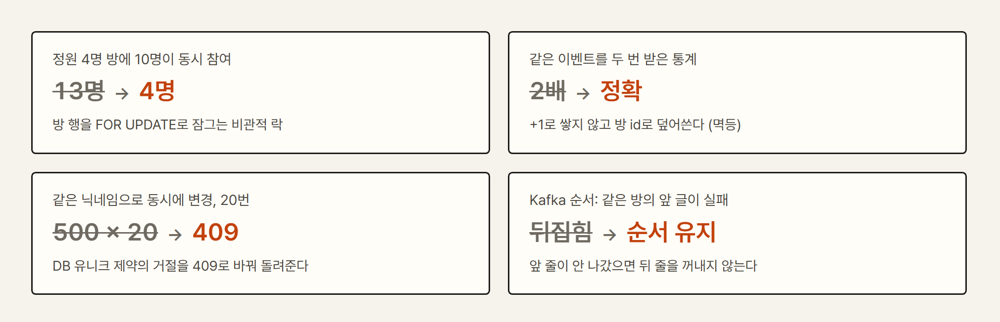](docs/images/perf/card-5-correctness.png)

**정원 4명 방에 13명이 들어갔다.**
자리가 하나 남은 방에 10명이 동시에 참여하자 10명 모두 성공했다. 기존 테스트 655개는 다 초록이었다. 전부 한 번에 한 명씩 들어오는 테스트였기 때문이다.
`@Version`을 붙여도 그대로 13명이었다. 참여는 방 행을 읽기만 하고 참여 행을 INSERT하므로, 버전을 검사할 UPDATE가 한 번도 일어나지 않았다.
방에 인원 칸을 두자 낙관적 락이 걸렸지만, 자리가 3개 남은 방에서는 진 사람이 재시도를 다 써 버렸다. 결국 방 행을 `FOR UPDATE`로 잠그며 읽는 비관적 락으로 정했다.
[기록](docs/JOURNAL.md#2026-10-15-자리가-하나-남은-방에-10명이-동시에-참여하자-정원-4명-방에-13명이-들어갔다)

**락 앞에 미리 보기를 하나 넣었더니 다시 13명이 들어가고, 방장의 취소가 지워졌다.**
꽉 찬 방에 온 사람을 락 앞에서 바로 돌려보내려고, 같은 트랜잭션 안에서 방을 락 없이 한 번 먼저 읽었다.
JPA는 처음 읽은 방 객체를 기억해 두었다가, 잠그며 다시 읽어도 그 옛 객체를 돌려줬다. 저장할 때 모든 칸을 덮어써서 앞에서 커밋된 취소도 모집중으로 되돌아갔다.
미리 보기를 트랜잭션 밖의 별도 클래스로 옮겼다([성능 개선 2](#2-참여-몰림-꽉-찬-방-요청을-락-앞에서-먼저-돌려보내기)).
[기록](docs/JOURNAL.md#2026-10-22-락-전에-인원을-미리-보자-정원-4명-방에-13명이-들어가고-방장의-취소가-사라졌다)

**Kafka에 같은 방의 SETTLING이 CLOSED보다 먼저 들어갔다.**
같은 방은 같은 파티션에 넣어 순서를 지키려 했는데, CLOSED 줄을 넣다가 한 번 실패하고 미뤄진 사이 SETTLING이 먼저 나갔다.
Kafka는 받은 순서만 지켜 줄 뿐이다. 같은 방의 앞 줄이 아직 안 나갔으면 뒤 줄을 꺼내지 않게 outbox를 꺼내는 쿼리에 조건을 달았다.
[기록](docs/JOURNAL.md#2026-10-26-같은-방의-앞-줄이-한-번-실패하자-kafka에-settling이-closed보다-먼저-들어갔다)

**같은 이벤트를 두 번 받자 통계가 두 배가 됐다.**
거점별 숫자에 +1로 쌓았더니, 같은 글을 다시 받거나 컨슈머 그룹을 되감으면 숫자가 두 배가 됐다.
끝난 방마다 사실 한 줄을 방 id로 덮어쓰고 지표는 볼 때 SQL로 세게 바꿨다. 몇 번 받아도 결과가 같다.
[기록](docs/JOURNAL.md#2026-10-27-통계를-더하기1로-쌓았더니-같은-글-두-번-되감기에서-숫자가-두-배가-됐다)

**같은 닉네임으로 동시에 바꾸면 20번 중 20번 한쪽이 500을 받았다.**
"이미 있는지 확인 → 저장"은 둘 다 확인을 통과할 수 있다. 진짜 막는 건 DB 유니크 제약이고, 그 거절을 409로 바꿔서 돌려준다.
[기록](docs/JOURNAL.md#2026-10-30-같은-닉네임으로-동시에-바꾸거나-가입하면-20번-중-20번-한쪽이-500이었다)

## 운영과 관측

**배포**
main은 PR로만 받고, Testcontainers(PostgreSQL, Redis, Kafka) 테스트가 CI에서 초록이어야 merge된다.
merge하면 CI가 끝난 뒤 Arm 이미지를 만들어 GHCR에 올리고, SSH로 서버에 배포한다. 새 버전이 healthy가 안 되면 마지막으로 성공한 버전으로 되돌린다.

**백업**
DB는 매일 새벽과 배포 직전에 백업한다. 빈 Postgres에 실제로 복구해 행 수를 비교한 뒤에만 Cloudflare R2에 올린다(14일 보관).
백업, 배치, 인증서 갱신은 끝날 때마다 healthchecks.io에 신호를 보낸다. 신호가 끊기면 메일이 온다. 서버가 통째로 죽어 "아예 안 돈" 경우도 잡힌다.

**요청 하나 따라가기**
바깥 Nginx가 요청마다 id를 만들어 자기 접속 기록에 남기고, 같은 id를 `X-Request-Id`로 backend에 넘긴다. backend는 그 id를 모든 로그 줄과 응답 헤더에 붙인다.
사용자가 "이 요청이 이상했다"고 하면 그 id 하나로 Loki에서 입구와 앱의 로그를 함께 찾는다.

[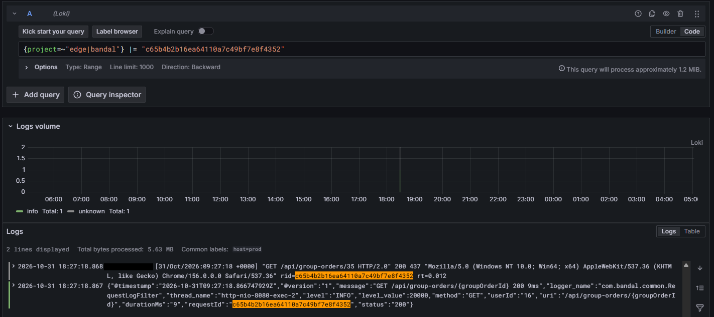](docs/images/perf/ops-15-loki-requestid.png)

입구(Nginx)에서 잰 전체 12ms, backend 안에서 9ms. 두 줄의 `rid`와 `requestId`가 같은 값이다. 접속 IP는 가렸다.

**알림 규칙**

[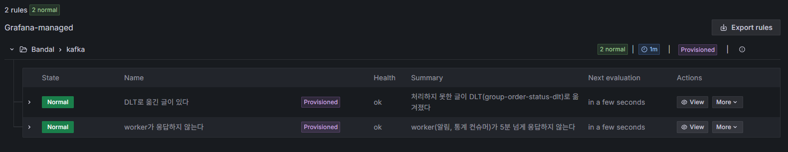](docs/images/perf/ops-16-alert-rules.png)

- DLT로 옮긴 글이 있다: 처리하지 못한 Kafka 글이 실패 보관함(DLT)으로 가면 바로 메일이 온다.
- worker가 응답하지 않는다: 알림, 통계 컨슈머가 5분 넘게 응답하지 않으면 메일이 온다.

규칙마다 대응 방법(어떤 명령으로 무엇을 보는지)을 설명에 적어 두었다.

**대시보드**
Grafana에서 요청별 응답 시간 p95/p99, 처리량, 에러율, DB 커넥션 풀, 커넥션 대기 시간, 락 잡는 조회 시간, 캐시 적중률, CPU, JVM 힙, Tomcat 스레드를 본다. 거점별 성사율 같은 서비스 통계는 Grafana가 DB를 읽기 전용 계정으로 읽어 보여 준다.

## 로컬에서 띄우기

```bash
docker compose up -d                       # PostgreSQL 5433, Redis 6380, Kafka 9094, Mailpit 8025

cd backend && ./gradlew bootRun            # http://localhost:8080 (dev 프로필, 개발용 데이터가 들어간다)

cd frontend && npm install && npm run dev  # http://localhost:5173
```

알림 컨슈머는 기본으로 꺼져 있다(운영에서는 worker 컨테이너만 켠다). 로컬에서 알림까지 보려면
`./gradlew bootRun --args='--app.kafka.consumers-enabled=true'`로 띄운다. 보낸 메일은 http://localhost:8025 에 쌓인다.

개발용 계정은 비밀번호가 모두 `password1234`다.

| 이메일 | 설명 |
| --- | --- |
| kim@hankuk.ac.kr | 계좌가 등록돼 있어 바로 방장이 될 수 있다 |
| lee@hankuk.ac.kr | 같은 학교 참여자 |
| park@minguk.ac.kr | 다른 학교. 위 두 사람의 방이 보이지 않는다 |

테스트는 `cd backend && ./gradlew test`. Testcontainers가 PostgreSQL, Redis, Kafka를 따로 띄우므로 Docker만 켜져 있으면 된다.

## 문서

| 파일 | 내용 |
| --- | --- |
| [DESIGN.md](DESIGN.md) | 무엇을 왜 만드는지, 도메인 모델, 상태 흐름, 배포 구조, 단계별 진행 |
| [docs/DECISIONS.md](docs/DECISIONS.md) | 설계 결정 94개. 결정마다 버린 대안과 버린 이유를 같이 적었다 |
| [docs/JOURNAL.md](docs/JOURNAL.md) | 실제로 겪은 문제 72개. 상황, 에러 메시지, 원인, 해결 순서 |
| [docs/NOTES.md](docs/NOTES.md) | 만들면서 공부한 개념 정리(flush, 락, 트랜잭션 전파, 그래프 읽는 법 같은 것) |
